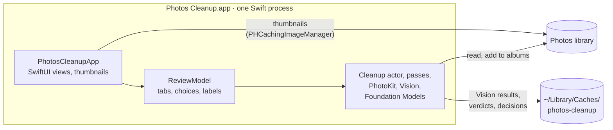
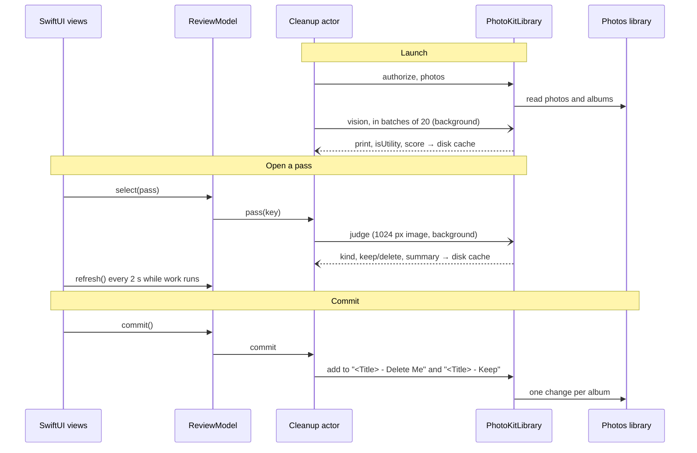

# Architecture

Photos Cleanup is a native macOS app, written in Swift and SwiftUI.
It reads the Photos library, suggests photos to clear, and files your choices into albums.
Everything runs on your Mac. The app never deletes photos. It only adds them to albums.

## Overview

## Modules

The Swift package has no dependencies.

| Target | Role |
|---|---|
| `PhotosCleanupCore` | No UI framework. The library access, the passes, the background jobs and the screen's model. The tests drive it with fakes. |
| `PhotosCleanupApp` | The SwiftUI app. Views only: every decision and label comes from `ReviewModel`. |

`PhotosCleanupCore` has five files:

| File | Role |
|---|---|
| `Library.swift` | The `PhotoLibrary` protocol and `PhotoKitLibrary`. It authorizes, lists photos, looks up assets, runs Vision (feature print, `isUtility`, aesthetics score) and adds photos to albums. |
| `Verdicts.swift` | The `Judge` protocol and `FoundationModelsJudge`. It returns kind, keep/delete and a short summary for one photo. It needs macOS 27 and Apple Intelligence. |
| `Passes.swift` | `Passes.all` (one key and title per pass), the tooltips, the thresholds, the candidate filter, time grouping and the similarity split. |
| `Cleanup.swift` | The `Cleanup` actor. It holds the photo list, the Vision job, the verdict queue, commits and the caches. |
| `Review.swift` | `ReviewModel` (`@Observable`, main actor). The current tab, keep/delete choices, Select all, what Commit sends, progress, the session's To be deleted list, and every label the screen shows. |

`PhotosCleanupApp` has three files:

| File | Role |
|---|---|
| `PhotosCleanupApp.swift` | The app and its window. It asks for Photos access, loads the library, then shows the review screen. |
| `ReviewScreen.swift` | Tabs, toolbar, banners and grids. Bursts show as one row per group. It refreshes the model every 2 s while work runs. |
| `Thumbnails.swift` | One `PHCachingImageManager`: high-quality thumbnails, cached about 30 rows ahead of the visible ones. The settings come from `spike/grid_probe.swift`. |

The tests fake `PhotoLibrary` and `Judge`, so they need no library and no Apple Intelligence.

## The passes

`Passes.all` gives each pass one key and one title.
The key names the view and the pass in `decisions.jsonl`. The title is the tab label and the album prefix.
Albums are always `<Title> - Delete Me` and `<Title> - Keep`.

| Pass | Candidates | Signal | Default |
|---|---|---|---|
| Screenshots | Screenshots | Foundation Models verdict | The verdict |
| Paperwork | Non-screenshot photos that Vision marks `isUtility` | Foundation Models verdict | The verdict. A "screenshot" verdict is always keep. |
| Bursts | Photos taken within 60 s of each other | Vision feature-print distance below 0.45. `isUtility` images never group. | Best aesthetics score: keep. Others: delete. |
| Low Quality | All other candidates | Vision aesthetics score at or below −0.75 | Delete |

Every pass skips favorites, videos, photos in your own albums, and photos already in its own albums.

## Data flow

1. **Launch.** The app asks for Photos access. `Cleanup.load()` reads the photo list once.
2. **Vision analysis.** A background job sends all still photos to `PhotoKitLibrary.vision` in batches of 20. Results go to a disk cache. Bursts, Low Quality and Paperwork read this cache.
3. **Verdicts.** When you open Screenshots or Paperwork, the classifier queues the photos with no verdict. It renders each as a 1024 px image and asks Foundation Models. Verdicts go to a disk cache. A photo the model cannot judge is not queued again until the next launch.
4. **Thumbnails.** The views ask `PHCachingImageManager` directly. Nothing is written to disk.
5. **Commit.** `Cleanup.commit` adds the photos to each album. It also logs your decision against the model's verdict.

Blocking PhotoKit and Vision calls run off the actor, so the screen never waits behind a batch.

## Caches

All caches are in `~/Library/Caches/photos-cleanup/`. Delete the folder to reset them.

| File | Contents | Reset when |
|---|---|---|
| `vision-38db2b8a.jsonl` | Feature print, `isUtility` and score per photo | You change `Cleanup.visionCache` |
| `verdicts-66bf2472.jsonl` | Foundation Models verdict per photo | You change `Cleanup.verdictCache` |
| `decisions.jsonl` | Your keep/delete against each verdict | Never |

The cache names are fixed constants in `Cleanup.swift`. Earlier versions derived the hashes from helper sources, and the constants keep those values so old caches still load.
The app does not detect a change in the Vision requests or the verdict prompt.
After such a change, rename the constant to force a recompute. Old files stay in the folder.

`~/Library/Application Support/photos-cleanup/albums_ignore` lists albums whose membership doesn't protect a photo.

## Security

- The app has its own Photos access. It needs no Full Disk Access.
- The release is signed with Developer ID, uses the hardened runtime and is notarized. The hardened runtime denies Photos access without the `com.apple.security.personal-information.photos-library` entitlement, so that is the app's one entitlement.
- The app makes no network calls and opens no port.

## Tools

| Area | Tools |
|---|---|
| Swift | SwiftPM, Swift 6 from the Xcode Command Line Tools, SwiftUI, swift-testing (`swift test`) |
| Bundle | `scripts/app.sh`: builds, assembles and signs the `.app` |
| Checks | pre-commit: linters, a Swift package build, gitleaks, markdownlint, codespell |
| Release | GitHub Actions on the `xcode-27` runner, notarization, and a Homebrew cask |

## Decisions

| Decision | Reason |
|---|---|
| Native SwiftUI app (0.4.0, 2026-10-29) | The grid spike showed PhotoKit thumbnails scroll smoothly for the whole library. One app replaces a server, a React UI and the Node toolchain, and gets its own Photos permission instead of the terminal's. |
| SwiftPM and a script, no Xcode project | The package already built everything. `scripts/app.sh` adds the bundle, the icon and the signature. |
| `ReviewModel` in Core, views hold no logic | The screen's rules are tested with the fakes, without a window. Core imports Observation, not SwiftUI. |
| Swift instead of Python | Vision, PhotoKit and Foundation Models are Swift APIs. One process needs no helper processes or JSON protocol. |
| PhotoKit, not osxphotos | PhotoKit is Apple's supported API. It needs Photos access instead of Full Disk Access, and it writes albums directly. |
| Vision aesthetics score for Low Quality | Apple's private score rated documents lowest. Vision rates accidental shots lowest, which is what the pass is for. |
| One background Vision pass for three passes | Each photo is analysed once. The cache makes later launches instant. |
