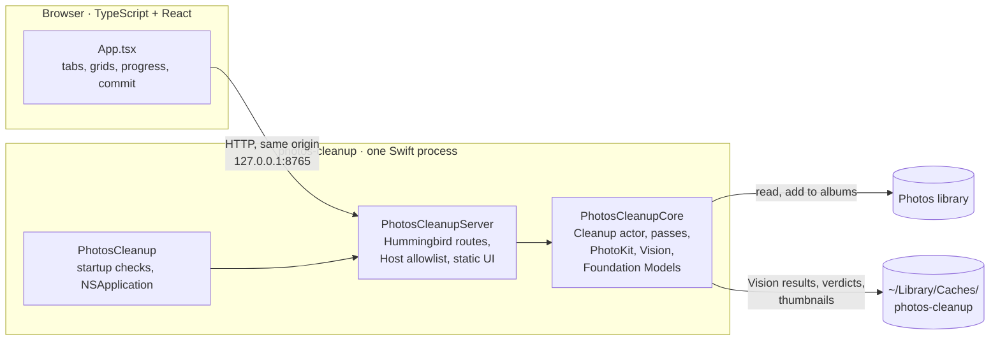
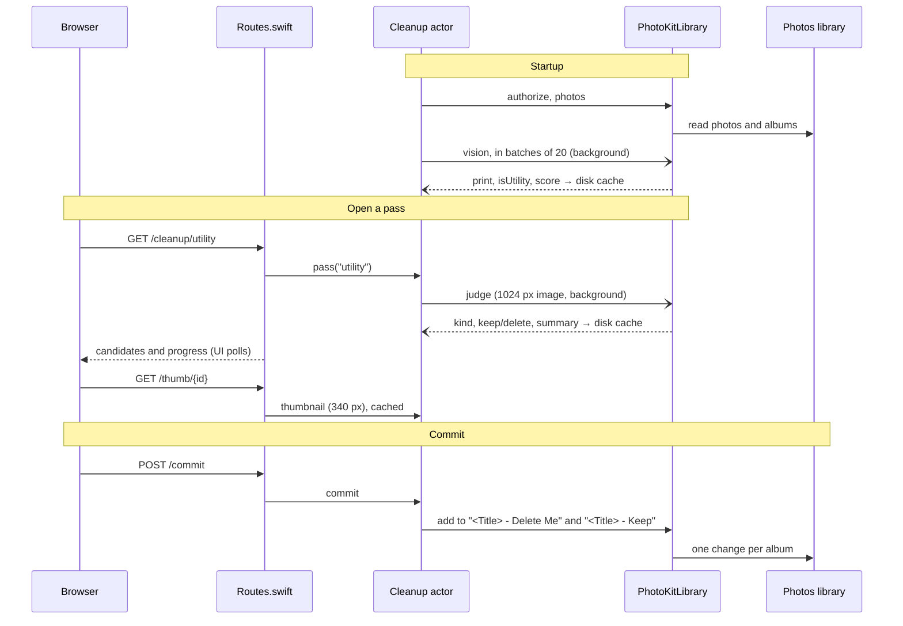

# Architecture

photos-cleanup is a local web app for macOS.
One Swift program reads the Photos library and serves a React UI to your browser.
Everything runs on your Mac. The app never deletes photos. It only adds them to albums.

## Overview

Each language does one job:

| Language | Job | Why this language |
|---|---|---|
| Swift | Server, pass logic, caching, startup checks, all contact with Apple frameworks | PhotoKit, Vision and Foundation Models are Apple APIs. Foundation Models is Swift-only. One process needs no helper protocol. |
| TypeScript + React | The UI: tabs, grids, keep/delete toggles, progress, commit | It runs in the browser. TypeScript catches errors at build time. |

## Modules

### Swift package: `Sources/`

| Target | Role |
|---|---|
| `PhotosCleanupCore` | Pure Swift with no web framework. A native app could import it. |
| `PhotosCleanupServer` | The HTTP API over Core. It holds the routes, the JSON shapes, the Host allowlist and the static UI. |
| `PhotosCleanup` | The `photos-cleanup` executable. It checks the port and Photos access, then runs the server. |

`PhotosCleanupCore` has four files:

| File | Role |
|---|---|
| `Library.swift` | The `PhotoLibrary` protocol and `PhotoKitLibrary`. It authorizes, lists photos, exports JPEGs, runs Vision (feature print, `isUtility`, aesthetics score) and adds photos to albums. |
| `Verdicts.swift` | The `Judge` protocol and `FoundationModelsJudge`. It returns kind, keep/delete and a short summary for one photo. It needs macOS 27 and Apple Intelligence. |
| `Passes.swift` | `Passes.all` (one key and title per pass), the thresholds, the candidate filter, time grouping and the similarity split. |
| `Cleanup.swift` | The `Cleanup` actor. It holds the photo list, the Vision job, the verdict queue, commits and the caches. |

The tests fake `PhotoLibrary` and `Judge`, so they need no library and no Apple Intelligence.

### Executable: `Sources/PhotosCleanup/`

`main.swift` holds `let version`. It parses options, then checks that the UI exists and the port is free.
The decisions behind those checks live in `Sources/PhotosCleanupServer/Startup.swift`, where tests cover them; `main.swift` only acts on them.
If the port serves `/health`, it reopens the browser and exits.
It starts a windowless `NSApplication`, because PhotoKit's `requestImage` returns nil in a plain command-line process.
It asks for Photos access, loads the photo list, starts the Vision job and runs the server.
`Info.plist` is embedded through linker flags in `Package.swift`, because PhotoKit needs a usage string to show its permission prompt.
The built UI is a SwiftPM resource. `pnpm build` writes it to `Sources/PhotosCleanup/ui/dist`.

### UI: `src/`

`App.tsx` holds the whole UI.
It shows one tab per pass and loads `/cleanup/<pass>`.
It polls while the server analyses or classifies, and shows a progress bar.
On commit, it sends the photos marked delete and keep to `/commit`.

## The passes

`Passes.all` gives each pass one key and one title.
The key is the URL and the UI view. The title is the tab label and the album prefix.
Albums are always `<Title> - Delete Me` and `<Title> - Keep`.

| Pass | Candidates | Signal | Default |
|---|---|---|---|
| Screenshots | Screenshots | Foundation Models verdict | The verdict |
| Utility | Non-screenshot photos that Vision marks `isUtility` | Foundation Models verdict | The verdict. A "screenshot" verdict is always keep. |
| Bursts | Photos taken within 60 s of each other | Vision feature-print distance below 0.45. Utility images never group. | Best aesthetics score: keep. Others: delete. |
| Low Quality | All other candidates | Vision aesthetics score at or below −0.75 | Delete |

Every pass skips favorites, videos, photos in your own albums, and photos already in its own albums.

## Data flow

1. **Startup.** `main.swift` checks access. `Cleanup.load()` reads the photo list once.
2. **Vision analysis.** A background job sends all still photos to `PhotoKitLibrary.vision` in batches of 20. Results go to a disk cache. Bursts, Low Quality and Utility read this cache.
3. **Verdicts.** When you open Screenshots or Utility, the classifier queues the photos with no verdict. It renders each as a 1024 px image and asks Foundation Models. Verdicts go to a disk cache. A photo the model cannot judge is not queued again until the next start.
4. **Thumbnails.** `/thumb/<id>` makes a 340 px JPEG once, then serves it from the cache.
5. **Commit.** `/commit` adds the photos to each album. It also logs your decision against the model's verdict.

Blocking PhotoKit and Vision calls run off the actor, so a request never waits behind a batch.

## Endpoints

| Endpoint | Returns |
|---|---|
| `GET /health` | `{"ok": true}` |
| `GET /photos` | All photos, newest first |
| `GET /thumb/{id}` | A 340 px JPEG |
| `GET /counts` | Photos per tab, or `null` while work is still running |
| `GET /cleanup/{pass}` | Candidates with verdicts (Bursts: groups with the best photo), plus progress |
| `POST /commit` | Adds photos to the pass's albums |
| `GET /verdict-stats` | How often your decisions matched the model, per pass |

Errors return `{"detail": "..."}`. The UI shows it on a failed commit.

## Caches

All caches are in `~/Library/Caches/photos-cleanup/`. Delete the folder to reset them.

| File | Contents | Reset when |
|---|---|---|
| `vision-38db2b8a.jsonl` | Feature print, `isUtility` and score per photo | You change `Cleanup.visionCache` |
| `verdicts-66bf2472.jsonl` | Foundation Models verdict per photo | You change `Cleanup.verdictCache` |
| `thumbs/` | 340 px JPEGs | Never; delete it by hand |
| `decisions.jsonl` | Your keep/delete against each verdict | Never |

The cache names are fixed constants in `Cleanup.swift`. Earlier versions derived the hashes from helper sources, and the constants keep those values so old caches still load.
The app does not detect a change in the Vision requests or the verdict prompt.
After such a change, rename the constant to force a recompute. Old files stay in the folder.

## Security

- The server listens on 127.0.0.1 only.
- A Host-header allowlist blocks DNS rebinding.
- The server sets no CORS headers, so other websites can't call the API.
- `/thumb` only accepts ids from the photo list, so a URL can't name another file.
- The app needs Photos access for the terminal that runs it. It needs no Full Disk Access.

## Tools

| Area | Tools |
|---|---|
| Swift | SwiftPM, Swift 6 from the Xcode Command Line Tools, Hummingbird, swift-testing (`swift test`) |
| TypeScript | `pnpm`, Vite (build), `tsc` |
| Checks | pre-commit: linters, a Swift package build, gitleaks, markdownlint, codespell |
| Release | GitHub Actions on macOS runners and a Homebrew tap. See [TODO.md](TODO.md#packaging-and-ci) for the pending switch to `swift build`. |

## Decisions

| Decision | Reason |
|---|---|
| Browser UI and a local server, not a native app | It is quick to build and runs from one command. The native SwiftUI rewrite was dropped on 2026-10-27. |
| Swift server instead of Python | Vision, PhotoKit and Foundation Models are Swift APIs. In one process, the helper processes, their JSON protocol, `swiftc` on first use and the PyPI/uv packaging all go away. |
| Core has no web framework | A native app could reuse it. The tests drive it with fakes, without HTTP. |
| PhotoKit, not osxphotos | PhotoKit is Apple's supported API. It needs Photos access instead of Full Disk Access, and it writes albums directly. |
| Vision aesthetics score for Low Quality | Apple's private score rated documents lowest. Vision rates accidental shots lowest, which is what the pass is for. |
| One background Vision pass for three passes | Each photo is analysed once. The cache makes later starts instant. |
