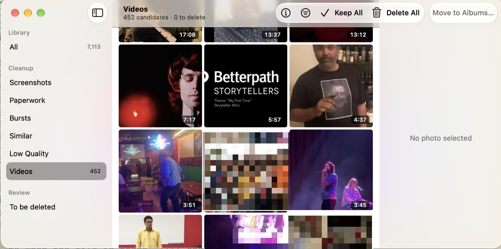

# photos-cleanup


Photos Cleanup is a free Mac app. It clears screenshots, bursts, look-alikes and blurry shots out of your Photos library.

Open it, and Overview shows how many photos each pass has to review. Click Start Cleanup. The app picks the best shot of each burst and marks the rest. You check its marks and press Return.

- **Built for big libraries.** One key accepts a whole section. Work through 30,000 photos over several sittings: the app saves your place.
- **Asked once.** A photo you keep is never suggested again. Run it after each import, and it shows only the new photos.
- **Says why.** "Why this photo?" lists what the app measured: its Vision score, face quality, your edits. Can't decide? Mark it Unsure and come back later.
- **Never deletes on its own.** Nothing changes in Photos until you click Apply to Photos… and confirm. Photos keeps deleted photos for 30 days.
- **Private.** Everything runs on your Mac, with no network calls. Apple's on-device Vision and Apple Intelligence do the analysis.
- **Free and open source.** No subscription, no account, no daily delete limit.

```bash
brew install --cask khivi/photos-cleanup/photos-cleanup
```

Or download the zip from the [latest release](https://github.com/khivi/photos-cleanup/releases/latest), unzip it and move "Photos Cleanup" to Applications.

It also does two jobs around the library:

- **Export** backs up every photo and video to a folder or disk. Each run copies only what is new or changed.
- **Import** checks folders of old photos against your library. It sorts the files you already have from the ones to bring into Photos.



## Safety

**Nothing is deleted until you say so.**

- Marking a photo Remove and accepting it changes nothing in Photos. It waits in Not in Photos Yet, and Undo reverses it.
- Photos are deleted only when you click Apply to Photos… and confirm in the macOS dialog. The Apply dialog warns you first if they are not in your export.
- Deleted photos stay in Photos' Recently Deleted for 30 days.

**Some photos are protected from the start.**

- Favorites are never suggested. Photos in your own albums are not either, unless you change it in Settings.
- Photos you edited start as keep in Bursts, Similar and Low Quality.
- Photos you keep go into one album, "Photos Cleanup - Keep". No pass suggests them again.

**Export and Import never delete files.**

- Export only adds and updates files in its destination.
- Import only moves files inside the folder you give it. It never changes your library.

## Privacy

**Everything stays on your Mac.** The app makes no network calls and sends no telemetry.

It uses only Apple's on-device tools:

- PhotoKit, to read your library and file photos into albums.
- Vision, to find bursts and low-quality photos.
- Foundation Models, for the screenshot and paperwork suggestions.

Photos itself may download from iCloud: a photo stored only in iCloud downloads when you preview or export it.

What the app saves, all inside its sandbox container `~/Library/Containers/com.khivi.photos-cleanup/Data/Library`:

| What | Where | To clear it |
| --- | --- | --- |
| Analysis and suggestions | `Caches/photos-cleanup` | Delete the folder |
| Your decisions, pending photos and album settings | `Application Support/photos-cleanup` | Delete the folder |
| Your Import and Export folders | the app's preferences | Remove the folders in Import, or choose another Export folder |

## Requirements

- macOS 15 or later
- Optional, for AI verdicts: macOS 27 or later with Apple Intelligence on

Without AI verdicts, Screenshots starts every photo as keep and Paperwork stays empty. All other passes work.
The app says why. See AI verdicts unavailable, under Troubleshooting.

## Install

Install with Homebrew, or download the zip from the [latest release](https://github.com/khivi/photos-cleanup/releases/latest).
The app is signed and notarized by Apple.

```bash
brew install --cask khivi/photos-cleanup/photos-cleanup
```

This installs "Photos Cleanup" in Applications.
To upgrade, run `brew upgrade --cask photos-cleanup`.

Versions up to 0.3.1 were a `photos-cleanup` command that opened a browser UI.
To move from it, run `brew uninstall photos-cleanup`, then install the cask.

To build from source, see [CONTRIBUTING.md](CONTRIBUTING.md).

## Permissions

The app needs one macOS permission: Photos access, with Full Access.

1. Open Photos Cleanup. The first time, macOS asks if it may access your Photos.
2. Click Allow Full Access.

To change this later, open System Settings > Privacy & Security > Photos.
If access is off, the app shows an Open Privacy Settings button.

Export and Import ask for folder access the first time they use a folder on another disk, or in Documents, Desktop or Downloads.
Click Allow.

Show in Photos (⌘R) needs a second, optional permission: Automation for Photos.
The first time you use it, macOS asks if Photos Cleanup may control Photos. Click OK.
To change this later, open System Settings > Privacy & Security > Automation.

## Usage

1. The app opens on Overview: how many photos each pass has to review. Click Start Cleanup, or pick a pass in the sidebar.
   Start Cleanup goes through the passes in order, with "step 3 of 7" and one bar across the top that fills as you accept. An empty pass offers Continue to the next. Picking a pass yourself hides the bar.
2. Check the recommendations. A pass shows one section at a time, with its place in the header ("Burst 12 of 847"). The ★ in Bursts and Similar is the best shot; photos to remove are dimmed and tagged Remove.
3. Fix any mark: ⌫ switches a photo between Keep and Remove. Can't decide? Press ? to mark it Unsure: accepting its section moves it to Unsure, under Cleanup, for later.
4. Click Accept (shortcut: Return), or Keep All (shortcut: K) to keep every photo in the section and accept it. The section leaves the pass and waits in Not in Photos Yet, and the next one opens. Nothing changes in Photos yet, and Undo (toolbar, ⌘Z) reverses it.
5. Click Apply to Photos…. The dialog counts what will be deleted per pass. macOS then asks you to confirm the deletion. The rest go to "Photos Cleanup - Keep".
6. Come back after your next import. The passes show only photos you haven't reviewed.

Not in Photos Yet, under Review, lists what you accepted by album. Select photos there and click Send Back to Review to change your mind. The list is saved, so it survives a quit.
The header above the grid counts the photos you keep and remove, and says what the pass recommends; hover it for how. Marks stay when you switch to another view.

| Pass | Finds | Starts as Remove |
| --- | --- | --- |
| Screenshots | Screenshots | The ones the on-device model calls junk |
| Paperwork | Receipts, tickets, documents, labels | The ones the model calls junk |
| Bursts | Repeated shots of one scene, within a minute | All but the best of each group |
| Similar | The same scene on one day | All but the best of each group |
| Low Quality | Blurry, dark or accidental shots, worst first | All |
| Videos | Videos, longest first | Clips under 2 seconds |

In Bursts and Similar, the best shot is the one whose worst face Vision rates best: sharp, well lit, facing the camera. Without faces, it's the one Vision scores highest.

A tile marks a Live Photo "Live" and a screen recording "Screen recording".

Every pass is in sections: a group in Bursts and Similar, a month, quarter or year in the others, newest first.
Settings (⌘,), Sections, sets the period: Auto (the default) picks the finest one that keeps a pass to 25 sections or fewer.
The change applies at once.
A pass shows one section at a time. Bursts and Similar show the best shot (★ Best shot) large, with the other shots below it. The other passes show the section's photos as a grid.
Select the ★, or select nothing, and the Info panel's "Why this photo?" lists what the app measured: its Vision score against the group's, its face quality where faces counted, an edit, or your pick.
In Bursts and Similar, hover a photo and click its ☆ (or right-click it and pick Pick as Best; shortcut: 1–9). That photo becomes the group's ★ and is kept; the rest are marked Remove. Nothing is accepted until you press Return or click the group's Accept.
What's left in a pass is what you haven't accepted, so you can work through a big one over several sittings.

Mark a photo Unsure (?) when you can't decide. Accepting its section moves it to Unsure, so the pass still empties.
Unsure lists those photos by the pass they came from. Mark each Keep (K) or Remove (⌫), then click the section's Accept: they go to Not in Photos Yet with the pass they came from.
Unsure is saved, so it survives a relaunch.
When every pass and Unsure are empty, the app says "Cleanup complete".

| Key | Action |
| --- | --- |
| Click, ⇧-click, ⌘-click, ⌘A | Select |
| Arrow keys | Move the selection within the section |
| Return | Same as Accept: accept the section and go to the next |
| 1–9 | In Bursts and Similar: pick photo N of the group as best (★); the rest are marked Remove |
| K | In a pass: same as Keep All, keep every photo in the section and accept it. In Unsure: mark Keep |
| ⌫ | Switch between Keep and Remove |
| ? | Mark unsure: it moves to Unsure when its section is accepted |
| Space, Esc | Show or close the large preview (videos play) |
| ⌘I | Show the Info panel: date, albums, and why the photo was picked |
| ⌘R | Show the photo in Photos |
| ⌘Z / ⇧⌘Z | Same as the toolbar Undo button / redo |
| ⌥⌘D | Show only photos marked delete |
| ⌘+ / ⌘− | Larger / smaller thumbnails |
| ⌥↓ / ⌥↑ | Next / previous section |

With VoiceOver on, each photo reads its kind, date and mark.

## Export: back up your library

Export copies every photo and video in your library to a folder or disk.
It includes hidden photos and every frame of a burst.

1. Open Export in the sidebar, under Transfer.
2. Click Choose… and pick a folder or disk.
3. Click Export Now.

The first run copies everything. Later runs copy only photos that are new or changed in Photos.
The sidebar badge shows how many photos still need copying.
Click Stop at any time. The next Export Now continues where it stopped.

The export looks like this:

```text
<destination>/2014/05/IMG_0001.HEIC         the original
<destination>/2014/05/IMG_0001_edited.JPG   your edit, if you edited it in Photos
<destination>/2014/05/IMG_0001.MOV          the video of a Live Photo
<destination>/undated/…                     photos with no date
<destination>/.photos-export.tsv            what each run copied
```

Two photos with the same name in one month get `IMG_0001 (1)` and so on.
A photo stays in the export after you delete it from Photos. Export never deletes.
Photos that are stored only in iCloud download first, so a first run can take hours.
Export runs 4 downloads at a time.
If a photo fails, Export lists it. The next run tries it again.

The Apply dialog warns you when photos it will delete are not in your export yet.
Run Export before Apply to keep a copy.

## Import: bring old photos into Photos

Import checks a folder of old photos (backups, old laptops, scans, downloads) against your library.
It finds the files you already have, so you import only the rest.
It never writes to your library: you import in Photos.

1. Open Import in the sidebar, under Transfer.
2. Click Add Folder… and pick a folder. Import checks it.
3. Read the counts: how many files are new, already in your library, copies, and other files.
4. Click Sort into Done and Import… and confirm. The files move inside the folder.
5. Click Open Import in Photos. Photos shows its import window for the `Import` folder. Import the photos.
6. In Photos, open Utilities > Duplicates and merge any duplicates. See Duplicates, below.
7. In Photos Cleanup, click Check Again. Files you imported move from `Import` to `Done`.

After the sort, the folder holds:

| Folder | What is in it | What to do |
| --- | --- | --- |
| `Done` | Files already in your library, and copies of them | Nothing. Keep or delete them. |
| `Import` | Files not in your library | Import them in Photos (step 5). |
| `Check date` | New files with no camera date | Set the date in Photos after you import them. |
| `Removed` | Files whose photo you later merged or deleted in Photos | Nothing. Import never offers them again. |

Other files stay where they are.
Inside each of these folders, the paths match the original folder.

`Check date` is beside `Import`, so importing `Import` never takes these files by accident.
Photos dates a file with no camera date by when the file was copied, not when the photo was taken.
Import these on their own, then fix their dates in Photos with Image > Adjust Date and Time.
Check Again then finds them by file name and size.

How Import decides that a file is already in your library:

- **Same picture:** same pixel size and capture time as a library photo.
- **Time zones:** a capture time off by whole quarter hours, up to 14 hours, counts only with the same file name or the same picture.
- **Re-encoded copies:** files with other bytes but the same size, time and picture all count, for example several copies in one export.
- **Bursts:** frames taken in the same second are told apart by file name.
- **Live Photos and edits:** a Live Photo's video and an edit's `.aae` file go with their photo.
- **Exact copies** in the folder count as copies of the first one.
- **Delete Me:** photos in a Delete Me album count as not in your library.

`Done/manifest.tsv` records which library photo each file in `Done` stands for.
Check Again keeps that decision while the photo is in your library, so files do not move back and forth.

Import does not match a resized copy, for example a smaller export of a photo you have.
It counts as new. After you import it, Photos finds it as a duplicate. Merge it there (step 6).

Import cannot see Recently Deleted.
A photo you deleted in Photos in the last 30 days counts as new, and Photos then shows it as "Already Imported".
If you deleted it on purpose, delete the file.

Import checks one folder at a time.
The app remembers your folders, and checks a folder the first time you open it.

## Duplicates

The cleanup passes do not look for duplicate copies of a photo in your library. The Photos app does this better: it can merge copies.
Import keeps most duplicates out of your library before you import (see Import). Photos merges the ones that get through, such as resized copies.

1. In Photos, open Utilities > Duplicates in the sidebar. The album appears only after Photos finds duplicates.
2. Click Merge on a set, or select all and merge them at once.
3. Photos keeps the best copy and combines the keywords, captions, favorites and albums of the copies into it. The other copies go to Recently Deleted.

## Albums that protect photos

Passes skip favorites and photos in your own albums.
To change this, open Settings (⌘,):

- Albums that keep photos safe: All my albums, except these (the default), or Only these albums.
- With All my albums, list the albums whose photos can still be suggested.
- With Only these albums, list the albums that protect their photos. Photos in your other albums can be suggested. Photos Cleanup - Keep is always on the list.

Changes apply the next time the app opens.

## Troubleshooting

| Message | Fix |
| --- | --- |
| `Photos access is denied.` | Follow the steps in Permissions. |
| `Couldn't load the Photos library: ...` | Open the Photos app once to check the library, then reopen Photos Cleanup. |

### AI verdicts unavailable

Without AI verdicts, Screenshots lists its photos, but every photo starts as keep.
Paperwork stays empty: only the model can tell a receipt from a photo.
All other passes work as usual.
The note under the grid starts with the reason:

| Reason in the note | Cause | Fix |
| --- | --- | --- |
| `need macOS 27 or later with Apple Intelligence on` | macOS is older than 27. | Update macOS, then turn on Apple Intelligence. |
| `Foundation Models unavailable: …appleIntelligenceNotEnabled…` | Apple Intelligence is off. | Turn it on in System Settings > Apple Intelligence & Siri. |
| `Foundation Models unavailable: …modelNotReady…` | The model is still downloading. | Wait, then reopen Photos Cleanup. |
| `Foundation Models unavailable: …deviceNotEligible…` | This Mac cannot run Apple Intelligence. | None. Mark the photos yourself. |
| `need a build made with the macOS 27 SDK` | The app was built with an older Xcode. | Install the release from Homebrew, or build with Xcode 27. |

The app checks once, when it opens. After a fix, reopen Photos Cleanup.

Inside Screenshots and Paperwork, the same reason shows as `AI verdicts unavailable: …`.
`Vision analysis failed`, in any pass, means the on-device image analysis stopped for this run. Reopen Photos Cleanup to try again.

## Development

See [CONTRIBUTING.md](CONTRIBUTING.md).

## License

[GPL-3.0-only](LICENSE)
