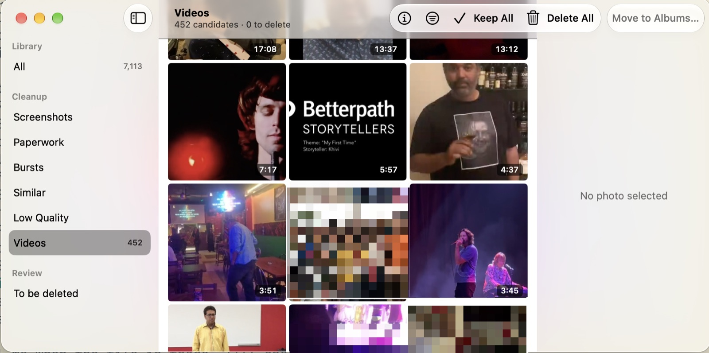

# photos-cleanup


Photos Cleanup is a free Mac app. It clears screenshots, bursts, look-alikes and blurry shots out of your Photos library.

- **Free and open source.** No subscription, no account, no daily delete limit.
- **Private.** Everything runs on your Mac, with no network calls. Apple's on-device Vision and Apple Intelligence do the analysis.
- **Never deletes on its own.** Your marks go into albums. You delete in Photos, and Photos keeps deleted photos for 30 days.
- **Fast on big libraries.** You review a whole pass in one grid and mark photos keep or delete with one key.

```bash
brew install --cask khivi/photos-cleanup/photos-cleanup
```

Or download the zip from the [latest release](https://github.com/khivi/photos-cleanup/releases/latest), unzip it and move "Photos Cleanup" to Applications.

It also does two jobs around the library:

- **Export** backs up every photo and video to a folder or disk. Each run copies only what is new or changed.
- **Import** checks folders of old photos against your library. It sorts the files you already have from the ones to bring into Photos.



## Safety

**Nothing is deleted until you say so.**

- Marking a photo delete only files it into an album, such as "Screenshots - Delete Me".
- Photos are deleted only when you click Delete in Photos… and confirm in the macOS dialog.
- Deleted photos stay in Photos' Recently Deleted for 30 days.

**Some photos are protected from the start.**

- Favorites are never suggested. Photos in your own albums are not either, unless you change it in Settings.
- Photos you edited start as keep in Bursts, Similar and Low Quality.
- Photos you keep go into a "Keep" album, such as "Screenshots - Keep". Later runs skip them.

**Export and Import never delete files.**

- Export only adds and updates files in its destination.
- Import only moves files inside the folder you give it. It never changes your library.

## Privacy

**Everything stays on your Mac.** The app makes no network calls and sends no telemetry.

It uses only Apple's on-device tools:

- PhotoKit, to read your library and file photos into albums.
- Vision, to find bursts and low-quality photos.
- Foundation Models, for the screenshot and paperwork suggestions.

Photos itself may download from iCloud: a photo stored only in iCloud downloads when you preview or export it.

What the app saves:

| What | Where | To clear it |
| --- | --- | --- |
| Analysis and suggestions | `~/Library/Caches/photos-cleanup` | Delete the folder |
| Your Import folder list | `~/Library/Application Support/photos-cleanup/import_folders` | Remove the folders in Import |

## Requirements

- macOS 15 or later
- Optional, for AI verdicts: macOS 27 or later with Apple Intelligence on

Without AI verdicts, Screenshots starts every photo as keep and Paperwork stays empty. All other passes work.
The app says why. See AI verdicts unavailable, under Troubleshooting.

## Install

Install with Homebrew, or download the zip from the [latest release](https://github.com/khivi/photos-cleanup/releases/latest).
The app is signed and notarized by Apple.

```bash
brew install --cask khivi/photos-cleanup/photos-cleanup
```

This installs "Photos Cleanup" in Applications.
To upgrade, run `brew upgrade --cask photos-cleanup`.

Versions up to 0.3.1 were a `photos-cleanup` command that opened a browser UI.
To move from it, run `brew uninstall photos-cleanup`, then install the cask.

To build from source, see [CONTRIBUTING.md](CONTRIBUTING.md).

## Permissions

The app needs one macOS permission: Photos access, with Full Access.

1. Open Photos Cleanup. The first time, macOS asks if it may access your Photos.
2. Click Allow Full Access.

To change this later, open System Settings > Privacy & Security > Photos.
If access is off, the app shows an Open Privacy Settings button.

Export and Import ask for folder access the first time they use a folder on another disk, or in Documents, Desktop or Downloads.
Click Allow.

Show in Photos (⌘R) needs a second, optional permission: Automation for Photos.
The first time you use it, macOS asks if Photos Cleanup may control Photos. Click OK.
To change this later, open System Settings > Privacy & Security > Automation.

## Usage

1. Pick a pass in the sidebar.
2. Check the suggestions. Only photos to delete are marked.
3. Fix any mark: K keeps, ⌫ deletes.
4. Click Move to Albums. Marked photos go to the pass's "Delete Me" album, the rest to its "Keep" album.
5. Open To be deleted and click Delete in Photos…. macOS asks you to confirm.

| Pass | Finds | Starts as delete |
| --- | --- | --- |
| Screenshots | Screenshots | The ones the on-device model calls junk |
| Paperwork | Receipts, tickets, documents, labels | The ones the model calls junk |
| Bursts | Repeated shots of one scene, within a minute | All but the best of each group |
| Similar | The same scene on one day | All but the best of each group |
| Low Quality | Blurry, dark or accidental shots, worst first | All |
| Videos | Videos, longest first | Clips under 2 seconds |

In Bursts and Similar, the best shot is the one whose worst face Vision rates best: sharp, well lit, facing the camera. Without faces, it's the one Vision scores highest.

A tile marks a Live Photo "Live" and a screen recording "Screen recording".

Bursts and Similar show one row per group: the best shot large, the others smaller beside it.
A long group ends in "+N"; click it, or select a photo in the group, to see the rest.

All shows every photo by month. Mark any photo delete there; it goes to "All - Delete Me".
Switch a month to Done to remember you reviewed it.

| Key | Action |
| --- | --- |
| Click, ⇧-click, ⌘-click, ⌘A | Select |
| Arrow keys | Move the selection; in Bursts and Similar, ↑ and ↓ move by group |
| K / ⌫ | Mark keep / delete; with one photo selected, move to the next |
| Space, Esc | Show or close the large preview (videos play) |
| ⌘I | Show the Info panel: date, albums, and why the photo was picked |
| ⌘R | Show the photo in Photos |
| ⌘Z / ⇧⌘Z | Undo / redo a mark |
| ⌥⌘D | Show only photos marked delete |
| ⌘+ / ⌘− | Larger / smaller thumbnails |
| ⌥↓ / ⌥↑ | Next / previous month or group |

With VoiceOver on, each photo reads its kind, date and mark.

## Export: back up your library

Export copies every photo and video in your library to a folder or disk.
It includes hidden photos and every frame of a burst.

1. Open Export in the sidebar, under Transfer.
2. Click Choose… and pick a folder or disk.
3. Click Export Now.

The first run copies everything. Later runs copy only photos that are new or changed in Photos.
The sidebar badge shows how many photos still need copying.
Click Stop at any time. The next Export Now continues where it stopped.

The export looks like this:

```text
<destination>/2014/05/IMG_0001.HEIC         the original
<destination>/2014/05/IMG_0001_edited.JPG   your edit, if you edited it in Photos
<destination>/2014/05/IMG_0001.MOV          the video of a Live Photo
<destination>/undated/…                     photos with no date
<destination>/.photos-export.tsv            what each run copied
```

Two photos with the same name in one month get `IMG_0001 (1)` and so on.
A photo stays in the export after you delete it from Photos. Export never deletes.
Photos that are stored only in iCloud download first, so a first run can take hours.
Export runs 4 downloads at a time.
If a photo fails, Export lists it. The next run tries it again.

To be deleted warns you when photos in it are not in your export yet.
Run Export before Delete in Photos… to keep a copy.

## Import: bring old photos into Photos

Import checks a folder of old photos (backups, old laptops, scans, downloads) against your library.
It finds the files you already have, so you import only the rest.
It never writes to your library: you import in Photos.

1. Open Import in the sidebar, under Transfer.
2. Click Add Folder… and pick a folder. Import checks it.
3. Read the counts: how many files are new, already in your library, copies, and other files.
4. Click Sort into Done and Import… and confirm. The files move inside the folder.
5. Click Open Import in Photos. Photos shows its import window for the `Import` folder. Import the photos.
6. In Photos, open Utilities > Duplicates and merge any duplicates. See Duplicates, below.
7. In Photos Cleanup, click Check Again. Files you imported move from `Import` to `Done`.

After the sort, the folder holds:

| Folder | What is in it | What to do |
| --- | --- | --- |
| `Done` | Files already in your library, and copies of them | Nothing. Keep or delete them. |
| `Import` | Files not in your library | Import them in Photos (step 5). |
| `Check date` | New files with no camera date | Set the date in Photos after you import them. |
| `Removed` | Files whose photo you later merged or deleted in Photos | Nothing. Import never offers them again. |

Other files stay where they are.
Inside each of these folders, the paths match the original folder.

`Check date` is beside `Import`, so importing `Import` never takes these files by accident.
Photos dates a file with no camera date by when the file was copied, not when the photo was taken.
Import these on their own, then fix their dates in Photos with Image > Adjust Date and Time.
Check Again then finds them by file name and size.

How Import decides that a file is already in your library:

- **Same picture:** same pixel size and capture time as a library photo.
- **Time zones:** a capture time off by whole quarter hours, up to 14 hours, counts only with the same file name or the same picture.
- **Re-encoded copies:** files with other bytes but the same size, time and picture all count, for example several copies in one export.
- **Bursts:** frames taken in the same second are told apart by file name.
- **Live Photos and edits:** a Live Photo's video and an edit's `.aae` file go with their photo.
- **Exact copies** in the folder count as copies of the first one.
- **Delete Me:** photos in a Delete Me album count as not in your library.

`Done/manifest.tsv` records which library photo each file in `Done` stands for.
Check Again keeps that decision while the photo is in your library, so files do not move back and forth.

Import does not match a resized copy, for example a smaller export of a photo you have.
It counts as new. After you import it, Photos finds it as a duplicate. Merge it there (step 6).

Import cannot see Recently Deleted.
A photo you deleted in Photos in the last 30 days counts as new, and Photos then shows it as "Already Imported".
If you deleted it on purpose, delete the file.

Import checks one folder at a time.
The app remembers your folders, and checks a folder the first time you open it.

## Duplicates

The cleanup passes do not look for duplicate copies of a photo in your library. The Photos app does this better: it can merge copies.
Import keeps most duplicates out of your library before you import (see Import). Photos merges the ones that get through, such as resized copies.

1. In Photos, open Utilities > Duplicates in the sidebar. The album appears only after Photos finds duplicates.
2. Click Merge on a set, or select all and merge them at once.
3. Photos keeps the best copy and combines the keywords, captions, favorites and albums of the copies into it. The other copies go to Recently Deleted.

## Albums that protect photos

Passes skip favorites and photos in your own albums.
To change this, open Settings (⌘,):

- Turn off Keep photos in albums to review photos in your own albums too.
- Add albums under Ignored albums to make only those not count.

Changes apply the next time the app opens.

## Troubleshooting

| Message | Fix |
| --- | --- |
| `Photos access is denied.` | Follow the steps in Permissions. |
| `Couldn't load the Photos library: ...` | Open the Photos app once to check the library, then reopen Photos Cleanup. |

### AI verdicts unavailable

Without AI verdicts, Screenshots lists its photos, but every photo starts as keep.
Paperwork stays empty: only the model can tell a receipt from a photo.
All other passes work as usual.
The note under the grid starts with the reason:

| Reason in the note | Cause | Fix |
| --- | --- | --- |
| `need macOS 27 or later with Apple Intelligence on` | macOS is older than 27. | Update macOS, then turn on Apple Intelligence. |
| `Foundation Models unavailable: …appleIntelligenceNotEnabled…` | Apple Intelligence is off. | Turn it on in System Settings > Apple Intelligence & Siri. |
| `Foundation Models unavailable: …modelNotReady…` | The model is still downloading. | Wait, then reopen Photos Cleanup. |
| `Foundation Models unavailable: …deviceNotEligible…` | This Mac cannot run Apple Intelligence. | None. Mark the photos yourself. |
| `need a build made with the macOS 27 SDK` | The app was built with an older Xcode. | Install the release from Homebrew, or build with Xcode 27. |

The app checks once, when it opens. After a fix, reopen Photos Cleanup.

Inside Screenshots and Paperwork, the same reason shows as `AI verdicts unavailable: …`.
`Vision analysis failed`, in any pass, means the on-device image analysis stopped for this run. Reopen Photos Cleanup to try again.

## Development

See [CONTRIBUTING.md](CONTRIBUTING.md).

## License

[MIT](LICENSE)
