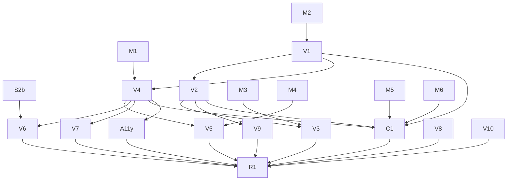

# TODO

## Stack — DECIDED 2026-10-29: native SwiftUI app

The app is a Swift package with no dependencies: `PhotosCleanupCore` plus the SwiftUI app, bundled and signed by `scripts/app.sh`.
All library access goes through PhotoKit, in-process. Vision and Foundation Models also run in-process.
Gone: the Python server and PyPI package (2026-10-28), osxphotos and Full Disk Access (2026-10-28), the Hummingbird server, React UI and Node toolchain (2026-10-29, after 0.4.0).
The grid spike (`spike/grid_probe.swift`, `feea7cb`, `5542d42`) settled native over the browser. An earlier decision against it (2026-07-22) is in commit `8320785`.
See [ARCHITECTURE.md](ARCHITECTURE.md).

Decided for the native app, starting 2026-10-29:

- **Build:** SwiftPM, plus a script that assembles and signs the `.app` bundle. No Xcode project.
- **Thumbnails:** the app owns a `PHCachingImageManager` (`.highQualityFormat`, caching ~30 rows ahead), as in the spike.
- **Core types:** make `Photo` `Identifiable` and replace `PassResult`'s tuples when the first SwiftUI view needs them.
- **Distribution:** Homebrew ships a cask, not a formula. The app asks for its own Photos permission.

Not pursuing:

- **Mac App Store.** It needs a sandboxed app bundle.

## Native app plan

### Phases 0-4

Done 2026-10-29: the app skeleton, Core types and view model, the screens, release 0.4.0, and removal of the web stack. Detail is in `git log` up to `68ea140`.
The hardened runtime denies Photos access without the `com.apple.security.personal-information.photos-library` entitlement, even with TCC at Full Access. `scripts/app.sh` signs with `Sources/PhotosCleanupApp/PhotosCleanup.entitlements`; set `SIGN_IDENTITY` for a Developer ID build.
Rebuilding the ad-hoc signed dev app did not ask for Photos access again.

### Phase 5: a native Mac design (release 0.5.0)

The window is still the browser layout in SwiftUI: bordered buttons as tabs, an inline toolbar, a red Commit button that is always visible. Phase 5 makes it look and work like Photos.app. `ReviewModel` keeps every label and decision; model tasks come with tests, view tasks only lay the model out.

Spikes, first: each answer can change a view task.

- [x] **S1, Quick Look (2026-10-29, `spike/quicklook_probe.swift`):** viable. `PHAssetResourceManager.writeData` writes the original in ~2ms (p95 4ms); when the original is only in iCloud it fails (`PHPhotosErrorDomain` 3164), and `requestImageDataAndOrientation` gives a smaller local copy instead. SwiftUI's `.quickLookPreview($url, in: urls)` opens on Space in ~57ms and pages with the arrow keys. Space needs the grid to hold keyboard focus (`@FocusState`). Temp files go in a directory the app deletes on quit.
- [x] **S2, Show in Photos (2026-10-29):** Photos' AppleScript `spotlight` command selects a photo by `PHAsset.localIdentifier`, including one outside the visible album: `spotlight (first media item whose id is "<id>")`. A plain `media item id "<id>"` fails (-1728) outside the visible album. Shipping it needs the `com.apple.security.automation.apple-events` entitlement, `NSAppleEventsUsageDescription`, and a one-time Automation prompt.
- [ ] **S2b:** by hand, with a Photos window open: does `spotlight` scroll Photos to the photo, or only select it? If only select, V6 drops "Show in Photos".
- [x] **S3, selection in the grid (2026-10-29, `spike/grid_probe.swift --select`):** passes, tested by hand on 7,390 photos. Click, ⇧-click, ⌘-click and ⌘A select; arrow keys move the selection and scroll it into view; fast scrolling with everything selected stays smooth. The simplest design is enough: one shared selection set, read by every cell (`@Observable`), a key handler on the focused `ScrollView`, and `ScrollPosition.scrollTo(id:)`. The automated `--autoscroll --select` run never measured: launched from a background shell, the window never came to the front.

Model (`Review.swift`, tests in `Tests/ReviewTests.swift`):

- [ ] **M1** Selection: a selected set; mark the selection Keep or Delete. `toggle` becomes marking one photo.
- [ ] **M2** Sidebar: sections (Library, Cleanup, Review) and badge counts from `ReviewModel.tabs`; no badge at 0. `everyPassHasOneName` keeps covering the titles.
- [ ] **M3** Commit preview: photos per album ("12 → Bursts - Delete Me"), matching what `commit()` moves.
- [ ] **M4** Burst headers: date and count per `BurstGroup`.
- [ ] **M5** Undo: marks go through an `UndoManager`, so ⌘Z works as in every Mac app.
- [ ] **M6** Verdict stats: `Cleanup.verdictStats()` per pass, agreement out of total.

Views:

- [ ] **V1** `NavigationSplitView` with the sidebar in place of the tab buttons.
- [ ] **V2** Window toolbar: title, subtitle ("41 candidates · 12 to delete"), Keep All / Delete All, progress, "Move to Albums…" (disabled at 0). The banner strip goes.
- [ ] **V3** Moving asks first: a confirmation dialog naming each album. Red only there.
- [ ] **V4** Grid selection from S3; K and ⌫ mark the selection.
- [ ] **V5** Bursts: one section per burst, ★ on the photo kept.
- [ ] **V6** Inspector (⌥⌘I): preview, verdict and reason, album, Keep/Delete, "Show in Photos" if S2b passes.
- [ ] **V7** Quick Look on Space, as S1.
- [ ] **V8** `ContentUnavailableView` for starting, no access, load failed and an empty pass.
- [ ] **V9** Thumbnail zoom: toolbar slider, ⌘+ / ⌘−, kept across launches.
- [ ] **V10** Settings window (⌘,) for the ignored albums. Also the "Keep photos in albums" toggle: a persisted setting, default on, which surfaces the existing default (candidates skip any photo in a user-created album, `candidatePhotos` in `Passes.swift`). Off needs candidate logic that includes album photos. Decide whether iCloud Shared Albums should protect photos; PhotoKit's album list leaves them out.
- [ ] **C1** Menu commands: View (⌘1–⌘6 per sidebar item, zoom, inspector, Verdict Stats… sheet from M6); Photo (Keep K, Delete ⌫, Keep All ⇧⌘K, Delete All ⇧⌘⌫, Quick Look Space, Show in Photos ⌘R, Move to Albums… ⌘↩).
- [ ] **A11y** VoiceOver: each cell reads its date, kind and mark; the sidebar reads its counts.

- [ ] **R1** README screenshot, ARCHITECTURE, then release 0.5.0. The docs must cover V7 writing original photos to a temp folder (ARCHITECTURE and SECURITY now say no image is written to disk), and V6's apple-events entitlement, `NSAppleEventsUsageDescription` and Automation prompt (entitlements file, Info.plist, README permissions).

Critical path: V4 → V5, V6, V7 → R1. M1–M5, V8 and V10 can start now. S2b is a hand test and blocks only V6's Show in Photos.

## Packaging and CI

Homebrew is the only install path: the cask in `khivi/homebrew-photos-cleanup` installs the signed, notarized app zip from each GitHub Release (v0.4.0 is the first; up to 0.3.1 a formula installed the command). The PyPI project `macos-photos-cleanup` is archived (2026-10-28). Release steps are in [CONTRIBUTING.md](CONTRIBUTING.md#release).

`ci.yml` runs `swift build` and `swift test` on `macos-latest` (no macOS 27 SDK: the no-verdicts fallback) and `xcode-27` (preview runner: verdicts compiled in). Dependabot opens monthly PRs with a 7-day cooldown.

## App

- [x] **Faster first Vision analysis** — `PhotoKitLibrary.vision` now runs the per-photo image fetch + Vision requests 4 at a time (`DispatchQueue.concurrentPerform`) inside each batch of 20. Measured on the real library (6802 photos, cache renamed away): 104.9 s sequential (65/s), 31.3 s concurrent (217/s), 3.4x; cache lines identical. `drainVision` logs `Vision: N photos in X s`. Only a first run or a new Mac pays it; later starts read the cache.
- [ ] **Measure verdicts against real choices** — `Cleanup.commit` logs the user's final decision against each verdict (`decisions.jsonl`; `Cleanup.verdictStats()` sums it). After real use of Screenshots and Paperwork, read the agreement rate (via M6 once it exists) and tune the prompt in `Sources/PhotosCleanupCore/Verdicts.swift`. Baseline: `f1751a9` (summary before `keep`, greedy, new kinds) matched 96/102 filed screenshots, but those filings mostly accepted the old preselected verdicts. Known miss: a medicine-box photo gets delete; adding "medical or health information" to the keep list didn't fix it and flipped another photo. Tried and dropped: asking for facts (`timeSensitive`/`reusableInfo`) and deciding in code — 66/101. After a prompt change, rename `Cleanup.verdictCache` to re-judge everything.
- [ ] **Recheck kept photos when the on-device model improves** — a pass's "Keep" album is the record of what was kept. Load it (hidden from candidates today), re-classify bypassing the verdict cache (a constant name today, so an OS model update alone doesn't invalidate it; key on the OS build too), show only new delete verdicts, and on commit move them Keep → Delete Me (needs album-removal code). Wait for an actual model update first.
