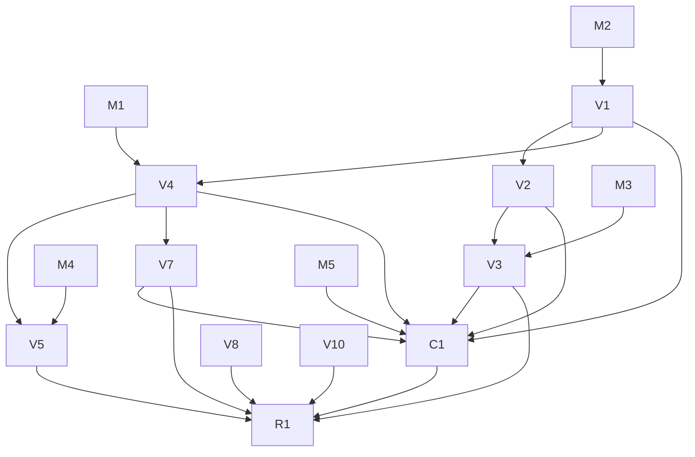

# TODO

## Stack — DECIDED 2026-10-29: native SwiftUI app

The app is a Swift package with no dependencies: `PhotosCleanupCore` plus the SwiftUI app, bundled and signed by `scripts/app.sh`.
All library access goes through PhotoKit, in-process. Vision and Foundation Models also run in-process.
Gone: the Python server and PyPI package (2026-10-28), osxphotos and Full Disk Access (2026-10-28), the Hummingbird server, React UI and Node toolchain (2026-10-29, after 0.4.0).
The grid spike (`spike/grid_probe.swift`, `feea7cb`, `5542d42`) settled native over the browser. An earlier decision against it (2026-07-22) is in commit `8320785`.
See [ARCHITECTURE.md](ARCHITECTURE.md).

Decided for the native app, starting 2026-10-29:

- **Build:** SwiftPM, plus a script that assembles and signs the `.app` bundle. No Xcode project.
- **Thumbnails:** the app owns a `PHCachingImageManager` (`.highQualityFormat`, caching ~30 rows ahead), as in the spike.
- **Core types:** `Photo` is `Identifiable`, and `PassResult`'s tuples are gone (Phase 1).
- **Distribution:** Homebrew ships a cask, not a formula. The app asks for its own Photos permission.

Not pursuing:

- **Mac App Store.** It needs a sandboxed app bundle.
- **Edited copies** (from the old command-line tool). Photos keeps edits inside the same photo; exported copies saved back are exact or near duplicates, which Photos' own Duplicates album (Albums → Utilities) finds.
- **HEIC savings estimate** (from the old command-line tool). Photos and iCloud already store new photos as HEIC, and converting goes through Photos' Export.
- **Threshold settings** (the old tool's `--threshold`, `--window`). The constants in `Passes` are set by eye on the real library; add a setting only when a pass's picks are wrong in practice.
- **Dry run** (the old tool's `--dry-run`). Nothing moves until Move to Albums is confirmed.
- **Face-based best pick** (decided 2026-10-30). `VNDetectFaceCaptureQualityRequest` would rank people shots by their worst face; the aesthetics ★ is rarely wrong in practice.
- **Side-by-side compare in a group** (decided 2026-10-30), as in PhotoSweeper's Face-to-Face. The ★ is rarely wrong, and ←/→ in the preview already flips between frames.
- **Streaks, widgets, reminders, video compression, Live Photo → still** (swipe apps, CleanMy Phone). Phone retention features; compression and conversion re-import through PhotoKit and lose metadata.

## Native app plan

### Phases 0-4

Done 2026-10-29: the app skeleton, Core types and view model, the screens, release 0.4.0, and removal of the web stack. Detail is in `git log` up to `68ea140`.
The hardened runtime denies Photos access without the `com.apple.security.personal-information.photos-library` entitlement, even with TCC at Full Access. `scripts/app.sh` signs with `Sources/PhotosCleanupApp/PhotosCleanup.entitlements`; set `SIGN_IDENTITY` for a Developer ID build.
Rebuilding the ad-hoc signed dev app did not ask for Photos access again.

### Phase 5: a native Mac design (release 0.5.0)

The window was the browser layout in SwiftUI: bordered buttons as tabs, an inline toolbar, a red Commit button that was always visible. Phase 5 makes it look and work like Photos.app. `ReviewModel` keeps every label and decision; model tasks come with tests, view tasks only lay the model out.

Spikes, first: each answer can change a view task.

- [x] **S1, Quick Look (2026-10-29, `spike/quicklook_probe.swift`):** viable. `PHAssetResourceManager.writeData` writes the original in ~2ms (p95 4ms); when the original is only in iCloud it fails (`PHPhotosErrorDomain` 3164), and `requestImageDataAndOrientation` gives a smaller local copy instead. SwiftUI's `.quickLookPreview($url, in: urls)` opens on Space in ~57ms and pages with the arrow keys. Space needs the grid to hold keyboard focus (`@FocusState`). Temp files go in a directory the app deletes on quit.
- [x] **S2, Show in Photos (2026-10-29):** Photos' AppleScript `spotlight` command selects a photo by `PHAsset.localIdentifier`, including one outside the visible album: `spotlight (first media item whose id is "<id>")`. A plain `media item id "<id>"` fails (-1728) outside the visible album. Shipping it needs the `com.apple.security.automation.apple-events` entitlement, `NSAppleEventsUsageDescription`, and a one-time Automation prompt.
- [x] **S3, selection in the grid (2026-10-29, `spike/grid_probe.swift --select`):** passes, tested by hand on 7,390 photos. Click, ⇧-click, ⌘-click and ⌘A select; arrow keys move the selection and scroll it into view; fast scrolling with everything selected stays smooth. The simplest design is enough: one shared selection set, read by every cell (`@Observable`), a key handler on the focused `ScrollView`, and `ScrollPosition.scrollTo(id:)`. The automated `--autoscroll --select` run never measured: launched from a background shell, the window never came to the front.

Model (`Review.swift`, tests in `Tests/ReviewTests.swift`):

- [x] **M1** Selection: a selected set; mark the selection Keep or Delete. `toggle` becomes marking one photo.
- [x] **M2** Sidebar: sections (Library, Cleanup, Review) and badge counts from `ReviewModel.tabs`; no badge at 0. `everyPassHasOneName` keeps covering the titles.
- [x] **M3** Commit preview: photos per album ("12 → Bursts - Delete Me"), matching what `commit()` moves. Also the new labels, which belong in `ReviewModel`: Commit becomes "Move to Albums…", and Select all ✓ Keep / ✗ Delete (hard-coded in `ReviewScreen.swift` today) become Keep All / Delete All.
- [x] **M4** Burst headers: date and count per `BurstGroup`.
- [x] **M5** Undo: marks go through an `UndoManager`, so ⌘Z works as in every Mac app. Marks only: Move to Albums can't be undone, since there is no album-removal code.
- ~~**M6** Verdict stats~~: dropped 2026-10-29. Built as a View menu sheet, then removed: not useful in the app. `Cleanup.verdictStats()` and `decisions.jsonl` stay for prompt tuning.

Views:

- [x] **V1** `NavigationSplitView` with the sidebar in place of the tab buttons.
- [x] **V2** Window toolbar: title, subtitle ("41 candidates · 12 to delete"), Keep All / Delete All, progress, "Move to Albums…" (disabled at 0). The banner strip goes.
- [x] **V3** Moving asks first: a confirmation dialog naming each album. Red only there.
- [x] **V4** Grid selection from S3. Arrows move the selection the same way in every view, Bursts included. K and ⌫ are Photo menu items (Keep, Delete), since Edit > Delete took ⌫ first; Undo and Redo are Edit menu commands on the model's `UndoManager`.
- [x] **V5** Bursts: grid sections with a date · count header, ★ on Vision's pick.
- [x] **V7** Large preview on Space, in the app: ←/→ page, K/⌫ mark, Esc closes. Not the Quick Look panel S1 tested, which would take the keys, so K/⌫ couldn't mark from the preview. It shows the local copy at once, then lets Photos download the full photo from iCloud, for the previewed photo only. It writes no files.
- [x] **V8** `ContentUnavailableView` for starting, no access, load failed and an empty pass.
- [x] **V10** Settings window (⌘,) for the ignored albums. Also the "Keep photos in albums" toggle: a persisted setting, default on, which surfaces the existing default (candidates skip any photo in a user-created album, `candidatePhotos` in `Passes.swift`). Off needs candidate logic that includes album photos. iCloud Shared Albums don't protect photos, only your own albums (decided 2026-10-29); PhotoKit's album list leaves them out anyway.
- [x] **C1** (Trimmed 2026-10-30: ⌘1–⌘n, ⌥⌘K, ⇧⌘⌫ and ⌘↩ dropped; the menu items stay.) Menu commands: View (⌘1–⌘6 per sidebar item); Photo (Keep K, Delete ⌫, Keep All ⌥⌘K, Delete All ⇧⌘⌫, Preview Space, Move to Albums… ⌘↩); Edit (Undo, Redo). Keep All is ⌥⌘K because ⇧⌘K is taken by another app on the user's Mac.

- [x] **R1** ARCHITECTURE and README for the new window (`4a487af`), no README screenshot; released as 0.5.0 (`046446f`, 2026-10-29): universal, SDK 27, notarized.

Phase 5 is done. The Inspector landed after it; zoom, VoiceOver and Show in Photos are future work under `## App`.

## Packaging and CI

Homebrew is the only install path: the cask in `khivi/homebrew-photos-cleanup` installs the signed, notarized app zip from each GitHub Release (v0.4.0 is the first; up to 0.3.1 a formula installed the command). The PyPI project `macos-photos-cleanup` is archived (2026-10-28). Release steps are in [CONTRIBUTING.md](CONTRIBUTING.md#release).

`ci.yml` runs `swift build` and `swift test` on `macos-latest` (no macOS 27 SDK: the no-verdicts fallback) and `xcode-27` (preview runner: verdicts compiled in), where it also builds and signs the `.app` with `scripts/app.sh`. Dependabot opens monthly PRs with a 7-day cooldown.

## App

- [x] **Inspector (was Phase 5's V6; `9ca4745`)** — a side panel for the selected photo, on ⌘I or the toolbar ⓘ, open state kept across launches: date, kind, verdict, "In album: …", the album it would move to, and Keep/Delete with undo.
- [x] **Faster first Vision analysis** — `PhotoKitLibrary.vision` now runs the per-photo image fetch + Vision requests 4 at a time (`DispatchQueue.concurrentPerform`) inside each batch of 20. Measured on the real library (6802 photos, cache renamed away): 104.9 s sequential (65/s), 31.3 s concurrent (217/s), 3.4x; cache lines identical. `drainVision` logs `Vision: N photos in X s`. Only a first run or a new Mac pays it; later starts read the cache.
- [ ] **Measure verdicts against real choices** — `Cleanup.commit` logs the user's final decision against each verdict (`decisions.jsonl`; `Cleanup.verdictStats()` sums it). After real use of Screenshots and Paperwork, read the agreement rate by hand, from `decisions.jsonl` or `Cleanup.verdictStats()`, and tune the prompt in `Sources/PhotosCleanupCore/Verdicts.swift`. Baseline: `f1751a9` (summary before `keep`, greedy, new kinds) matched 96/102 filed screenshots, but those filings mostly accepted the old preselected verdicts. Known miss: a medicine-box photo gets delete; adding "medical or health information" to the keep list didn't fix it and flipped another photo. Tried and dropped: asking for facts (`timeSensitive`/`reusableInfo`) and deciding in code — 66/101. After a prompt change, rename `Cleanup.verdictCache` to re-judge everything.
- [ ] **Recheck kept photos when the on-device model improves** — a pass's "Keep" album is the record of what was kept. Load it (hidden from candidates today), re-classify bypassing the verdict cache (a constant name today, so an OS model update alone doesn't invalidate it; key on the OS build too), show only new delete verdicts, and on commit move them Keep → Delete Me (needs album-removal code). Wait for an actual model update first.

### Similar pass (from the old command-line tool's `similar`) — done 2026-10-30 except step 4

The same scene shot minutes or days apart. Bursts only joins shots within 60 s of each other.

1. **Core** (`Passes.swift`, `Cleanup.swift`): a pass `("similar", "Similar")`, so its albums are "Similar - Delete Me" and "Similar - Keep". Candidates: the Bursts candidates (dated, not screenshots, not favorites) minus every photo already in a Bursts group, and minus utility images, which look alike. Group by calendar day. Within a day, in time order, a photo joins the first group whose first photo is within `Passes.similarMaxDistance` (the feature-print distance Bursts uses); otherwise it starts a group. Groups of one are dropped. Comparing to each group's first photo, not to any member, stops chains of slowly changing shots merging into one group. `ponytail:` per-day only, so a scene shot on two days stays two groups; widen to a week if that misses real repeats.
2. **Best and marks**: as Bursts, the highest Vision aesthetics score starts as Keep and the rest as Delete. Reuse `BurstGroup`, the grid sections and the ★; the Bursts-only checks become "a grouped pass" (`view == .pass("bursts")` today in `ReviewModel` and `ReviewScreen`).
3. **Tests**: same-day grouping, a photo two days later not joining, the first-photo rule against chaining, Bursts members excluded, utility excluded, best pick.
4. **Tune by eye**: like Bursts and Low Quality, look at 30–40 real groups; start at 0.45 and lower it if different photos join.
5. **Docs**: README pass list and tooltip (`Passes.about`), ARCHITECTURE passes table.

### From the competitor review (decided 2026-10-30)

Compared against CleanMy Phone, Gemini 2, PhotoSweeper, PowerPhotos, Slidebox/Swipewipe, Google Photos' Review and delete, and Photos' Utilities. The passes cover photos; the gap is videos.

- [x] **Mark and advance** — K / ⌫ with exactly one photo selected marks it and moves to the next (`moveSelection(by: 1)` in `markSelection`), in the grid and the preview. Several selected: stays. No setting. The swipe apps' one-key-per-photo flow.
- [x] **Edited photos** — `PHAsset.hasAdjustments` as `Photo.edited`. Low Quality: an edited photo starts Keep. Bursts and Similar: an edited frame wins the ★ (the highest-scored edited one if several), and every edited frame starts Keep. Screenshots and Paperwork are unchanged: markup and crops there don't mean keep.
- [x] **Delete in Photos…** — on To be deleted, delete the photos already in the Delete Me albums with `PHAssetChangeRequest.deleteAssets`. macOS shows its own confirmation, and Photos keeps them in Recently Deleted for 30 days. Move to Albums stays the review step. Changes the "never deletes" rule in README Safety, SECURITY, ARCHITECTURE and CLAUDE.md.
- [x] **All by month** — section headers in All ("October 2026 · 214"), reusing the grouped-pass sections. A Done mark per month, saved as `2024-03 312` (month and photo count) in the settings folder; a month whose count has grown shows as not done again.
- [x] **Video playback in the preview** — `PHImageManager.requestPlayerItem` and AVKit's `VideoPlayer`; Space, ←/→, K and ⌫ stay the app's keys. Both video passes need it: a poster frame doesn't show what a video is.
- [x] **Videos pass** — every video (not favorites, not in the user's albums), longest first by `PHAsset.duration`, the duration on each cell. Videos under ~2 s (accidental record taps; a `Passes` constant set by eye) start Delete, the rest Keep. Albums "Videos - Delete Me" / "Videos - Keep". Sort by size instead if Space freed lands.
- [ ] **By-hand check of the merge (2026-10-30)** — done: Delete in Photos… and Cancel (deletes nothing) on a throwaway photo; All's month headers and Done. Left: video playback (Space/←/→/K/⌫/Esc keep working while a video plays, audio stops on paging and close, iCloud-only videos download and play).
- [ ] **Screen Recordings pass** — `PHAssetMediaSubtypeVideoScreenRecording` (macOS 10.15+), read like `.photoScreenshot`. All start Delete, longest first. First count them in Photos (Albums → Utilities → Screen Recordings): if only a handful, leave them in Videos instead.
- [ ] **Saved Images: measure first** — WhatsApp/Telegram saves, memes, forwards. Count `PHAssetResource.originalFilename` matching `-WA\d+` and photos with no location. A few dozen: drop it. Thousands: design a pass that starts Keep and preselects Delete only where Vision finds no people (photos family send look the same by filename).

### Future (not next up)

- [ ] **Space freed per pass** — "Bursts · 66 · 1.2 GB" in the sidebar and the move dialog, like the old tool's savings report. PhotoKit has no public file size; `PHAssetResource`'s `fileSize` is an undocumented key. Only if the number matters. Not now (2026-10-30). If built: guard with `responds(to: Selector(("fileSize")))`, since a dropped key raises an Objective-C exception Swift can't catch; sum all of a photo's resources; the figure is iCloud storage, freed once deleted in Photos and Recently Deleted empties. Measure the per-asset cost on the real library first.

- [ ] **Thumbnail zoom (was Phase 5's V9)** — toolbar slider and ⌘+ / ⌘−, kept across launches; View menu items for both. Cells are 120–150pt today.
- [ ] **VoiceOver (was Phase 5's A11y)** — each cell reads its date, kind and mark; the sidebar reads its counts.
- [ ] **Show in Photos** — an Inspector button (⌘R) that opens Photos at the photo, through Photos' AppleScript `spotlight (first media item whose id is "<id>")`, which selects it (S2, Phase 5). First check by hand, with a Photos window open, whether it also scrolls Photos to the photo (S2b); if it only selects, drop the idea. Shipping it needs the `com.apple.security.automation.apple-events` entitlement, `NSAppleEventsUsageDescription` and a one-time Automation prompt, all in the docs (entitlements file, Info.plist, README permissions, SECURITY).
