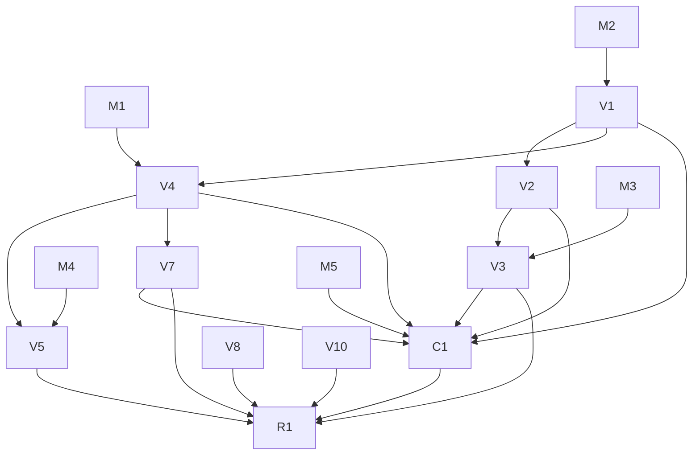

# TODO

## Stack — DECIDED 2026-10-29: native SwiftUI app

The app is a Swift package with no dependencies: `PhotosCleanupCore` plus the SwiftUI app, bundled and signed by `scripts/app.sh`.
All library access goes through PhotoKit, in-process. Vision and Foundation Models also run in-process.
Gone: the Python server and PyPI package (2026-10-28), osxphotos and Full Disk Access (2026-10-28), the Hummingbird server, React UI and Node toolchain (2026-10-29, after 0.4.0).
The grid spike (`spike/grid_probe.swift`, `feea7cb`, `5542d42`) settled native over the browser. An earlier decision against it (2026-07-22) is in commit `8320785`.
See [ARCHITECTURE.md](ARCHITECTURE.md).

Decided for the native app, starting 2026-10-29:

- **Build:** SwiftPM, plus a script that assembles and signs the `.app` bundle. No Xcode project.
- **Thumbnails:** the app owns a `PHCachingImageManager` (`.highQualityFormat`, caching ~30 rows ahead), as in the spike.
- **Core types:** `Photo` is `Identifiable`, and `PassResult`'s tuples are gone (Phase 1).
- **Distribution:** Homebrew ships a cask, not a formula; the Mac App Store ships a sandboxed build of the same app. The app asks for its own Photos permission.

Not pursuing:

- **Edited copies** (from the old command-line tool). Photos keeps edits inside the same photo; exported copies saved back are exact or near duplicates, which Photos' own Duplicates album (Albums → Utilities) finds.
- **HEIC savings estimate** (from the old command-line tool). Photos and iCloud already store new photos as HEIC, and converting goes through Photos' Export.
- **Threshold settings** (the old tool's `--threshold`, `--window`). The constants in `Passes` are set by eye on the real library; add a setting only when a pass's picks are wrong in practice.
- **Dry run** (the old tool's `--dry-run`). Nothing moves until Move to Albums is confirmed.
- **Date range** (the old tool's `--since`, `--last`, `--until`). Each pass's Keep album hides reviewed photos, so a rerun shows only new ones; All by month covers browsing by date.
- **Album name override** (the old tool's `--album-name`). A pass's albums are always derived from its title (`everyPassHasOneName`).
- **Side-by-side compare in a group** (decided 2026-10-30), as in PhotoSweeper's Face-to-Face. The ★ is rarely wrong, and ←/→ in the preview already flips between frames.
- **Screen Recordings pass** (decided 2026-10-30). The library has 4; they show in Videos.
- **Streaks, widgets, reminders, video compression, Live Photo → still** (swipe apps, CleanMy Phone). Phone retention features; compression and conversion re-import through PhotoKit and lose metadata.

## Native app plan

### Phases 0-4

Done 2026-10-29: the app skeleton, Core types and view model, the screens, release 0.4.0, and removal of the web stack. Detail is in `git log` up to `68ea140`.
The hardened runtime denies Photos access without the `com.apple.security.personal-information.photos-library` entitlement, even with TCC at Full Access. `scripts/app.sh` signs with `Sources/PhotosCleanupApp/PhotosCleanup.entitlements`; set `SIGN_IDENTITY` for a Developer ID build.
Rebuilding the ad-hoc signed dev app did not ask for Photos access again.

### Phase 5: a native Mac design (release 0.5.0)

The window was the browser layout in SwiftUI: bordered buttons as tabs, an inline toolbar, a red Commit button that was always visible. Phase 5 makes it look and work like Photos.app. `ReviewModel` keeps every label and decision; model tasks come with tests, view tasks only lay the model out.

Spikes, first: each answer can change a view task.

- [x] **S1, Quick Look (2026-10-29, `spike/quicklook_probe.swift`):** viable. `PHAssetResourceManager.writeData` writes the original in ~2ms (p95 4ms); when the original is only in iCloud it fails (`PHPhotosErrorDomain` 3164), and `requestImageDataAndOrientation` gives a smaller local copy instead. SwiftUI's `.quickLookPreview($url, in: urls)` opens on Space in ~57ms and pages with the arrow keys. Space needs the grid to hold keyboard focus (`@FocusState`). Temp files go in a directory the app deletes on quit.
- [x] **S2, Show in Photos (2026-10-29):** Photos' AppleScript `spotlight` command selects a photo by `PHAsset.localIdentifier`, including one outside the visible album: `spotlight (first media item whose id is "<id>")`. A plain `media item id "<id>"` fails (-1728) outside the visible album. Shipping it needs the `com.apple.security.automation.apple-events` entitlement, `NSAppleEventsUsageDescription`, and a one-time Automation prompt.
- [x] **S3, selection in the grid (2026-10-29, `spike/grid_probe.swift --select`):** passes, tested by hand on 7,390 photos. Click, ⇧-click, ⌘-click and ⌘A select; arrow keys move the selection and scroll it into view; fast scrolling with everything selected stays smooth. The simplest design is enough: one shared selection set, read by every cell (`@Observable`), a key handler on the focused `ScrollView`, and `ScrollPosition.scrollTo(id:)`. The automated `--autoscroll --select` run never measured: launched from a background shell, the window never came to the front.

Model (`Review.swift`, tests in `Tests/ReviewTests.swift`):

- [x] **M1** Selection: a selected set; mark the selection Keep or Delete. `toggle` becomes marking one photo.
- [x] **M2** Sidebar: sections (Library, Cleanup, Review) and badge counts from `ReviewModel.tabs`; no badge at 0. `everyPassHasOneName` keeps covering the titles.
- [x] **M3** Commit preview: photos per album ("12 → Bursts - Delete Me"), matching what `commit()` moves. Also the new labels, which belong in `ReviewModel`: Commit becomes "Move to Albums…", and Select all ✓ Keep / ✗ Delete (hard-coded in `ReviewScreen.swift` today) become Keep All / Delete All.
- [x] **M4** Burst headers: date and count per `BurstGroup`.
- [x] **M5** Undo: marks go through an `UndoManager`, so ⌘Z works as in every Mac app. Marks only: Move to Albums can't be undone, since there is no album-removal code.
- ~~**M6** Verdict stats~~: dropped 2026-10-29. Built as a View menu sheet, then removed: not useful in the app. `decisions.jsonl` stays for prompt tuning; `verdictStats()` was dropped 2026-11-02 for a `jq` one-liner (below).

Views:

- [x] **V1** `NavigationSplitView` with the sidebar in place of the tab buttons.
- [x] **V2** Window toolbar: title, subtitle ("41 candidates · 12 to delete"), Keep All / Delete All, progress, "Move to Albums…" (disabled at 0). The banner strip goes.
- [x] **V3** Moving asks first: a confirmation dialog naming each album. Red only there.
- [x] **V4** Grid selection from S3. Arrows move the selection the same way in every view, Bursts included. K and ⌫ are Photo menu items (Keep, Delete), since Edit > Delete took ⌫ first; Undo and Redo are Edit menu commands on the model's `UndoManager`.
- [x] **V5** Bursts: grid sections with a date · count header, ★ on Vision's pick.
- [x] **V7** Large preview on Space, in the app: ←/→ page, K/⌫ mark, Esc closes. Not the Quick Look panel S1 tested, which would take the keys, so K/⌫ couldn't mark from the preview. It shows the local copy at once, then lets Photos download the full photo from iCloud, for the previewed photo only. It writes no files.
- [x] **V8** `ContentUnavailableView` for starting, no access, load failed and an empty pass.
- [x] **V10** Settings window (⌘,) for the ignored albums. Also the "Keep photos in albums" toggle: a persisted setting, default on, which surfaces the existing default (candidates skip any photo in a user-created album, `candidatePhotos` in `Passes.swift`). Off needs candidate logic that includes album photos. iCloud Shared Albums don't protect photos, only your own albums (decided 2026-10-29); PhotoKit's album list leaves them out anyway.
- [x] **C1** (Trimmed 2026-10-30: ⌘1–⌘n, ⌥⌘K, ⇧⌘⌫ and ⌘↩ dropped; the menu items stay.) Menu commands: View (⌘1–⌘6 per sidebar item); Photo (Keep K, Delete ⌫, Keep All ⌥⌘K, Delete All ⇧⌘⌫, Preview Space, Move to Albums… ⌘↩); Edit (Undo, Redo). Keep All is ⌥⌘K because ⇧⌘K is taken by another app on the user's Mac.

- [x] **R1** ARCHITECTURE and README for the new window (`4a487af`), no README screenshot; released as 0.5.0 (`046446f`, 2026-10-29): universal, SDK 27, notarized.

Phase 5 is done. The Inspector landed after it; zoom, VoiceOver and Show in Photos are future work under `## App`.

## Packaging and CI

Homebrew is the only install path: the cask in `khivi/homebrew-photos-cleanup` installs the signed, notarized app zip from each GitHub Release (v0.4.0 is the first; up to 0.3.1 a formula installed the command). The PyPI project `macos-photos-cleanup` is archived (2026-10-28). Release steps are in [CONTRIBUTING.md](CONTRIBUTING.md#release).

`ci.yml` runs `swift build` and `swift test` on `macos-latest` (no macOS 27 SDK: the no-verdicts fallback) and `xcode-27` (preview runner: verdicts compiled in), where it also builds and signs the `.app` with `scripts/app.sh`. Dependabot opens monthly PRs with a 7-day cooldown.

## App

- [x] **Live Photos and Selfies passes: built, then removed** (2026-11-07; built in `afcf2ae`, never released). Every photo started as Keep with no signal, so each pass was only a copy of Photos' own album. Selfie retakes are what a sweep finds, and Bursts and Similar already catch them. The "Live" tile tag stays (`Photo.live`).
- [x] **Job progress in the sidebar, not the toolbar** (done 2026-11-07). Every pass row shows a filling ring while its count is unknown, then its count, 0 included: a ring or a number. Exception: Paperwork before it is opened, whose count waits on verdicts that only start in the pass, stays blank.
  - Paperwork, Bursts, Similar, Low Quality: the Vision ring (already in `1dd75da`), tooltip "Analysing photos on this Mac: N of M".
  - Screenshots, Paperwork: the verdict ring once Vision is done for the pass, tooltip "Checking photos with Apple Intelligence: N of M"; only on a pass with photos in the queue (screenshots → Screenshots, the rest → Paperwork). One ring per row.
  - `Cleanup.verdictStatus()` beside `visionStatus()`; `ReviewModel.verdictJob` and `jobsRunning`; the counts poll in `ReviewScreen` runs while `countsPending || jobsRunning`, so rings move in any view.
  - 0 shows as a badge (macOS hides `.badge(0)`: a text badge). The toolbar `ProgressView` goes; errors stay where they show.
  - Tests, each failing without its change: verdict ring and tooltip on the queued pass only; a finished empty pass shows 0; the toolbar-label test becomes a sidebar-tooltip test.
- [x] **Feature prints out of RAM** (done 2026-11-07, `0b0cb2b`). Prints are 3 KB each: 117 MB for 38k photos, ~600 MB at 200k. Bursts and Similar only ask whether two prints are within `similarMaxDistance`, so `Cleanup.near` keeps those pairs (~1 MB here; median 1 look-alike per photo, p99 12) and the prints stay in the Vision cache.
  - Pairs: same calendar day, or within `burstWindow` (a burst across midnight). A Vision batch reads only its days' prints back, by each line's byte range.
  - Groups identical to before on the real library; grouping 0.082 → 0.036 s.
  - Not taken: Float16 prints (lossless, half the memory; moot once prints leave RAM), dropping utility photos' prints (15%), a binary or mmapped cache.
  - Launch pairs a run of days at a time (`Cleanup.pairAll`), reading prints back by byte range: the load peak fell 544 → 52 MB here, pairing took 0.14 → 1.5 s, off the main thread. The log line gives the peak (`ledger_phys_footprint_peak`).
- [x] **Memory in the log** (done 2026-11-07, `0d182d3`). `footprintMB()` (`phys_footprint`, Activity Monitor's figure): "Loaded: N photos, memory N MB" after load, and the Vision line ends with the footprint. No UI: nobody can act on the number. 38–40 MB after load here.
- [x] **Inspector (was Phase 5's V6; `9ca4745`)** — a side panel for the selected photo, on ⌘I or the toolbar ⓘ, open state kept across launches: date, kind, verdict, "In album: …", the album it would move to, and Keep/Delete with undo.
- [x] **Faster first Vision analysis** — `PhotoKitLibrary.vision` now runs the per-photo image fetch + Vision requests 4 at a time (`DispatchQueue.concurrentPerform`) inside each batch of 20. Measured on the real library (6802 photos, cache renamed away): 104.9 s sequential (65/s), 31.3 s concurrent (217/s), 3.4x; cache lines identical. `drainVision` logs `Vision: N photos in X s`. Only a first run or a new Mac pays it; later starts read the cache.
- [x] **Measure verdicts against real choices** — closed 2026-11-02: the log agrees 1367/1367 (paperwork) and 33/33 (screenshots), because filings accept the preselection; it can't tune the prompt until choices override verdicts. Baseline: `f1751a9` (summary before `keep`, greedy, new kinds) matched 96/102 filed screenshots, but those filings mostly accepted the old preselected verdicts. Known miss: a medicine-box photo gets delete; adding "medical or health information" to the keep list didn't fix it and flipped another photo. Tried and dropped: asking for facts (`timeSensitive`/`reusableInfo`) and deciding in code — 66/101. After a prompt change, rename `Cleanup.verdictCache` to re-judge everything.
- ~~**Recheck kept photos when the on-device model improves**~~: dropped 2026-11-02, no model update yet and filings accept verdicts (33/33). Design kept: a pass's "Keep" album is the record of what was kept. Load it (hidden from candidates today), re-classify bypassing the verdict cache (a constant name today, so an OS model update alone doesn't invalidate it; key on the OS build too), show only new delete verdicts, and on commit move them Keep → Delete Me (needs album-removal code). Wait for an actual model update first.

### Similar pass (from the old command-line tool's `similar`) — done 2026-10-30

The same scene shot minutes or days apart. Bursts only joins shots within 60 s of each other.

1. **Core** (`Passes.swift`, `Cleanup.swift`): a pass `("similar", "Similar")`, so its albums are "Similar - Delete Me" and "Similar - Keep". Candidates: the Bursts candidates (dated, not screenshots, not favorites) minus every photo already in a Bursts group, and minus utility images, which look alike. Group by calendar day. Within a day, in time order, a photo joins the first group whose first photo is within `Passes.similarMaxDistance` (the feature-print distance Bursts uses); otherwise it starts a group. Groups of one are dropped. Comparing to each group's first photo, not to any member, stops chains of slowly changing shots merging into one group. `ponytail:` per-day only, so a scene shot on two days stays two groups; widen to a week if that misses real repeats.
2. **Best and marks**: as Bursts, the highest Vision aesthetics score starts as Keep and the rest as Delete. Reuse `BurstGroup`, the grid sections and the ★; the Bursts-only checks become "a grouped pass" (`view == .pass("bursts")` today in `ReviewModel` and `ReviewScreen`).
3. **Tests**: same-day grouping, a photo two days later not joining, the first-photo rule against chaining, Bursts members excluded, utility excluded, best pick.
4. **Threshold: not tuned, by decision (2026-11-07)**. Similar uses Bursts' `similarMaxDistance` (0.45), set by eye on Bursts. Same-day pair distances here show no gap near it (~3,000 pairs at 0.425–0.45, ~3,500 at 0.45–0.475), so no number is clearly right. A wrong group costs a glance: every group is seen before Move to Albums, and Recently Deleted keeps photos 30 days. Change it only when Similar shows groups that aren't repeats: then split the constant (Bursts keeps 0.45) and lower Similar's.
5. **Docs**: README pass list and tooltip (`Passes.about`), ARCHITECTURE passes table.

### From the competitor review (decided 2026-10-30)

Compared against CleanMy Phone, Gemini 2, PhotoSweeper, PowerPhotos, Slidebox/Swipewipe, Google Photos' Review and delete, and Photos' Utilities. The passes cover photos; the gap is videos.

- [x] **Mark and advance** — K / ⌫ with exactly one photo selected marks it and moves to the next (`moveSelection(by: 1)` in `markSelection`), in the grid and the preview. Several selected: stays. No setting. The swipe apps' one-key-per-photo flow.
- [x] **Edited photos** — `PHAsset.hasAdjustments` as `Photo.edited`. Low Quality: an edited photo starts Keep. Bursts and Similar: an edited frame wins the ★ (the highest-scored edited one if several), and every edited frame starts Keep. Screenshots and Paperwork are unchanged: markup and crops there don't mean keep.
- [x] **Delete in Photos…** — on To be deleted, delete the photos already in the Delete Me albums with `PHAssetChangeRequest.deleteAssets`. macOS shows its own confirmation, and Photos keeps them in Recently Deleted for 30 days. Move to Albums stays the review step. Changes the "never deletes" rule in README Safety, SECURITY, ARCHITECTURE and CLAUDE.md.
- [x] **All by month** — section headers in All ("October 2026 · 214"), reusing the grouped-pass sections. A Done mark per month, saved as `2024-03 312` (month and photo count) in the settings folder; a month whose count has grown shows as not done again.
- [x] **Video playback in the preview** — `PHImageManager.requestPlayerItem` and AVKit's `VideoPlayer`; Space, ←/→, K and ⌫ stay the app's keys. Both video passes need it: a poster frame doesn't show what a video is.
- [x] **Videos pass** — every video (not favorites, not in the user's albums), longest first by `PHAsset.duration`, the duration on each cell. Videos under ~2 s (accidental record taps; a `Passes` constant set by eye) start Delete, the rest Keep. Albums "Videos - Delete Me" / "Videos - Keep". Sort by size instead if Space freed lands.
- [x] **By-hand check of the merge (2026-10-30)** — Delete in Photos… and Cancel (deletes nothing) on a throwaway photo; All's month headers and Done; video playback with the app's keys.
- ~~**Saved Images: measure first**~~: dropped 2026-11-02, measured: 0 of 29,413 photos named like WhatsApp (`-WA#`) or Telegram saves; the 16,091 without location are old camera files and scans. Was: Photos (macOS 27) has its own Recently Saved and Captured by Me albums, which PhotoKit doesn't expose; check Recently Saved's size in Photos first. WhatsApp/Telegram saves, memes, forwards. Count `PHAssetResource.originalFilename` matching `-WA\d+` and photos with no location. A few dozen: drop it. Thousands: design a pass that starts Keep and preselects Delete only where Vision finds no people (photos family send look the same by filename).

### Shredly review (2026-11-07)

Shredly: Photo Cleaner 1.0.1, iPhone/iPad, free with 30 deletions a day. Decisions:

- **Taken, then removed:** Live Photos and Selfies categories (the item above): no signal, so nothing to suggest.
- **Declined: anything sorted by size** (large videos, smart categories by size, a size sort option). No file sizes are read.
- **Already here:** undo; nothing deleted until confirmed, then 30 days in Recently Deleted; bursts and screenshots (with on-device verdicts); month by month (All, month Done); video playback in the preview.
- **Not taking:** the shredder, paper-ball mode, themes, haptics, the month celebration, one-photo-at-a-time swiping (a grid is faster for thousands).
- **Taken and done (2026-11-07, `afcf2ae`): screen recordings singled out in Videos.** `PHAssetMediaSubtype.videoScreenRecording` (macOS 10.15+) gives `Photo.screenRecording`; the tile and Inspector say "Screen recording". Marks unchanged (clips under 2 s still start as Delete).
- **Taken and done (2026-11-07, `afcf2ae`): a Live Photo is marked "Live"** on its tile and in the Inspector (from `Photo.live`, the Live Photos pass's flag). Its motion doesn't play: the still is enough to decide.

### PicSift review (2026-11-07)

PicSift: Find Your Best Photos 1.0.1, iPad and Mac, free with a one-time unlock. Decisions:

- **Taken and done (2026-11-07): face-aware best shot in Bursts and Similar.** Reverses the 2026-10-30 decline ("the aesthetics ★ is rarely wrong"), which was a judgment, not a measurement: the aesthetics score doesn't look at faces, so a blink can take the ★ and the good frame starts as Delete.
  - `analyse()` adds `VNDetectFaceCaptureQualityRequest`; `VisionResult.face` is the worst face at least 5% of the frame high, 0 with none. About +4 ms on 6 ms of Vision per photo, warmed up; image loading dominates, so analysis is ~20% slower.
  - Rows cached before faces have none; a grouped pass analyses its members again, once, on the Vision ring. Nothing outside a group is redone.
  - Pick: edited, then the face rounded to 0.1 (closer faces tie), then the aesthetics score. Only when every shot in the pool is checked and one has a face. Info panel: "Score 0.12 · face 0.30 · ★ face 0.80".
  - The log says how many groups faces changed ("bursts: faces changed the best shot in N of M groups"): the evidence for keeping it.
- **Already here:** Delete Tray (Delete Me albums and Delete in Photos…, 30 days in Recently Deleted); duplicates keep the best (Bursts, Similar); keyboard marks and undo, bulk too; per-photo ratings (⌘I); background scoring with progress (sidebar rings).
- **Not taking:** the six-quality Priorities chart, sliders and presets (ranking for posting, not clearing out); the swipe deck (the grid with K/⌫ to next covers it); Visual Search, People, Places, Smart Albums (Photos has them); Straighten (editing); a reset key.

### Visibility for users (2026-11-07)

Homebrew reaches only developers who already know the app. Users search the App Store, Google and Reddit for a "photo cleaner".

- [x] **README leads with what sets it apart:** free with no delete limit, on-device, never deletes on its own; Homebrew and the zip download at the top.
- [x] **GitHub:** description and topics (`photo-cleaner`, `duplicate-photos`, `privacy`, `on-device-ai`, …); v0.9.0 notes for users; CONTRIBUTING release step 6 for later releases.
- [ ] **Social preview:** `docs/social-preview.png` (1280×640). Upload it in Settings > General > Social preview; GitHub has no API for it.
- [ ] **Landing page:** one GitHub Pages page (headline, screenshots or a GIF, Download button to the latest release, requirements), set as the repo homepage.
- [ ] **Listings:** posts on r/macapps and r/apple; Show HN (lead with the on-device Vision and Foundation Models work); pull requests to `serhii-londar/open-source-mac-os-apps` and `jaywcjlove/awesome-mac`; AlternativeTo (beside Gemini Photos, PhotoSweeper, CleanMy Phone) and MacUpdate; Product Hunt once the landing page is up. Claude drafts; the user posts.
- [ ] **Official Homebrew cask** (`brew install --cask photos-cleanup` without the tap). Homebrew turns down repos that aren't yet well known, about 75 stars.
- **Mac App Store**
  - [x] App Sandbox; Import and Export folders kept as security-scoped bookmarks (`e6b4e88`, `362e71e`, 2026-11-09).
  - [x] Show in Photos hidden in the store build: no Apple Events exception (`0bd5295`, 2026-11-10).
  - [x] `scripts/app.sh store` builds the signed `.pkg`: Apple Distribution signing, `AppStore.provisionprofile` (expires 2027-11-10) (`0bd5295`, 2026-11-10).
  - [x] App Store Connect record "Photos Cleanup: On-Device AI" (app ID 6833111040; "Photos Cleanup" was taken), 2026-11-10.
  - [x] Build 0.11.0 (274), from the v0.11.0 commit, uploaded with Transporter (266, older, unused), 2026-11-10.
  - [x] Store listing: privacy policy (`PRIVACY.md`), listing fields, review notes and three screenshots in `docs/app-store/` (`b3655d8`, `1b67ddd`); version 1.0 renamed 0.11.0.
  - [x] Submitted for review, manual release, 2026-11-10.
  - [ ] TestFlight check of 274: Photos access, Import and Export folders kept across relaunch, no Show in Photos.
  - [ ] After approval: Release This Version in App Store Connect.
  - [ ] An Import screenshot from a sample folder with a neutral path (the demo's is under `.build/`).
  - [ ] Later: a CI job in `release.yml` that builds the store `.pkg` and uploads it to App Store Connect (TestFlight); review stays manual. Needs an App Store Connect API key that may upload, and the Apple Distribution and installer certificates as a `.p12` secret.
- Say on every page: macOS 15 or later; Screenshots and Paperwork verdicts need macOS 27 with Apple Intelligence.

### Future (not next up)

- ~~**Space freed per pass**~~: dropped 2026-11-02, needs an undocumented PhotoKit key; photo counts suffice. Notes kept: "Bursts · 66 · 1.2 GB" in the sidebar and the move dialog, like the old tool's savings report. PhotoKit has no public file size; `PHAssetResource`'s `fileSize` is an undocumented key. Only if the number matters. Not now (2026-10-30). If built: guard with `responds(to: Selector(("fileSize")))`, since a dropped key raises an Objective-C exception Swift can't catch; sum all of a photo's resources; the figure is iCloud storage, freed once deleted in Photos and Recently Deleted empties. Measure the per-asset cost on the real library first.

- ~~**Skipped counts**~~: dropped 2026-11-02, no one asked; first thing to build if a pass looks too small. (From the old command-line tool's "Skipped:" line) — why a photo isn't a candidate: "Skipped: 120 favorited, 300 in your albums, 4 undated". `candidatePhotos` in `Passes.swift` returns the counts; they show in the empty state and the window subtitle.

- ~~**Thumbnail zoom (was Phase 5's V9)**~~: dropped 2026-11-02, the adaptive grid and Space preview cover it. Was: toolbar slider and ⌘+ / ⌘−, kept across launches; View menu items for both. Cells are 120–150pt today.
- [x] **VoiceOver (was Phase 5's A11y)** (2026-11-02) — each cell reads its date, kind and mark; the sidebar reads its counts.
- [x] **Show in Photos** (2026-11-02, Info panel button and ⌘R) — an Inspector button (⌘R) that opens Photos at the photo, through Photos' AppleScript `spotlight (first media item whose id is "<id>")`, which selects it (S2, Phase 5). S2b checked 2026-11-02: with a Photos window open, it scrolls Photos to the photo and selects it. Shipping it needs the `com.apple.security.automation.apple-events` entitlement, `NSAppleEventsUsageDescription` and a one-time Automation prompt, all in the docs (entitlements file, Info.plist, README permissions, SECURITY).

## photos-import: Done and Import (2026-11-02)

Decided: import stays through Photos (drag or File → Import, for its duplicate detection); the tool stays read-only on the library, and moves files only within the folder.

- [x] **False "in library" matches** — any 15-minute offset within ±14 h at the same size and second matched. In `OLD PHOTOS/Keep`, 55 of 124 offset matches and 134 of 138 cross-folder "same shot" matches were other pictures (16×16 thumbnail compare). Now: exact time first (EXIF read in the Mac's zone, or with `OffsetTimeOriginal`), then the nearest offset confirmed by file name or thumbnail.
- [x] **Delete Me counts as in library** — Delete Me photos are left out of the library index.
- [x] **`--plan` replaced** — the tool moves into `Done/` and `Import/` itself, file by file; hidden files and unscanned files stay.
- [x] **Wrong dates after import** — of 20,931 photos imported 2026-10-31, ~2,140 had no camera date and Photos took the file creation date (when the backup was copied); ~23 had junk EXIF years (1900, 17, 1719). These now go to `Import/Check date/`; after fixing the date in Photos, a rerun matches them by file name and size.
- ~~**Suggest the date for Check date files**~~: dropped 2026-11-02, measured: 1 of 1,037 Check date files has a usable date in its name (the rest are bare numbers and .xmp sidecars). Was: many carry it in the file name (`IMG_0008.2014-06-01_164455.JPG`, `20120916-191041-=-IMG_0290.JPG`) or folder name (`…, May 10, 1992`). Write it to the report.
- [x] **Done/ is rechecked** — each run moves a photo in `Done/` that the library lacks back to `Import/`. The old `--plan` sent every copy to Done, even of photos never imported: ~9,000 such files in `OLD PHOTOS` (2026-11-02).
- [x] **Sticky decisions** — `Done/manifest.tsv`: path → library photo uuid. Re-judging every file each run let moves change verdicts (four separate swap bugs in `2739ef3`); a recorded decision holds until its photo leaves the library or goes to Delete Me.
- [x] **`--skip` exports** — built (`importPlanSortsIntoDoneAndImport`): never moved by the tool. An export is a deletion record (keeps deleted photos' copies from showing as new).
- [x] **Tests for the Done logic** — the move plan is `ImportScan.plan` in Core, tested in `ImportTests.swift`.

## Export and Import in the app (2026-11-02)

Photos Takeout stalls on "Fetching assets" with 0 photos (likely no Photos access) and isn't wanted.

- [x] ~~Try osxphotos first~~ — dropped: Export in the app does the same incremental backup with the app's own Photos access.
- [x] **A `photos-export` target** (`989f9bc`). `PHAssetResourceManager.writeData` per resource; a manifest of photo uuid → modification date so a rerun copies only new or changed photos. Hard parts: iCloud "Optimize Storage" downloads (slow, network), Live Photo pairs, edits plus originals, name collisions, and photos deleted from the library (kept: a backup doesn't lose files).
- [x] **Export in the app** (`4f4c60b`) — Transfer → Export in the sidebar: destination, free space, last export, counts, progress, Stop, failures. The badge counts photos to copy; To be deleted warns about photos not in the export. `photos-export` wraps the same `Exporter`.
- [x] **A full export run** — done on the real library. Was: check iCloud downloads, Live Photo pairs and edits, and that a stopped run resumes.
- [x] **Parallel downloads** (2026-11-02) — `Exporter.parallel` = 4 exports in flight; naming and the manifest stay on the actor.
- ~~**Export: grid of photos to copy, size estimate**~~: dropped 2026-11-02, counts and the failure list cover it; size needs an undocumented PhotoKit key. Was: the grid of what isn't exported yet, and "needs ~X GB" next to free space.
- [x] **Import in the app** (`6d9e4b7`) — Transfer → Import: checked folders (kept in Application Support) with counts per status, Sort into Done and Import…, Open Import in Photos. Same `Importer` as `photos-import`, which is now a wrapper (same results as `2739ef3` on PhotosBackup and PhotoScans). No library exports in the app: one folder at a time.
- ~~**Import: a file grid**~~: dropped 2026-11-02, Photos' import window already shows the new files and flags duplicates. Was: one folder's files by status (QuickLook thumbnails), the Info panel showing the library match with Show in Photos.
- ~~**Import: Recently Deleted**~~: dropped 2026-11-02, trash the file instead; a Move to Done would need a no-photo row in the sticky manifest. Was: PhotoKit can't see it, so a photo deleted in Photos comes back as new; Photos then refuses it as "Already Imported" for 30 days. A Move to Done button for files the user decides against.
